# DEASys user guide

*Accounts, under control.*

**DEASys:** free, self-hosted double-entry accounting for any business with branches. It runs on your own Windows or Linux machine, and you use it in your browser.

- Double-entry books with maker, checker and authorizer approvals.
- Sales invoices and purchase bills, approved, then posted to the ledger.
- Customers and vendors with statements, ageing and reminders.
- Receipts, payments, contra and journals, settled bill by bill.
- GST on invoices: tax engine, GSTIN, HSN and SAC rates.
- GST returns data with tie-out checks, freeze and filing status.
- GSTR-2A and 2B reconciliation of purchase credit against bills.
- E-invoice and e-way bill data, sent by an external connector.
- TDS and TCS on payments, with challans, returns data and certificates.
- Branches, cost centres and budgets, with warn or block controls.
- Multiple currencies, exchange rates and forex revaluation.
- Cheque books, cheque printing and a post-dated cheque register.
- Bank statements, reconciliation and NEFT bank files.
- Financial statements and reports: CSV, Excel and PDF export.
- Day and year close, role-based permissions and an audit log.
- Integrations: API keys, inbox and webhooks for ERP, HRMS and payroll.

Not included by design: inventory, HR and payroll. Connect those systems through the API.

The sections below are the full guide. DEASys is double-entry accounting software. The sections explain what each part does, how to install and set it up, the daily and periodic work, reports, administration and integrations.

> **Version and downloads (placeholders).** This guide describes **DEASys v0.1.0**.
> - Installer: `DEASys-0.1.0-win64-setup.exe` (placeholder download URL: `<DOWNLOAD URL>`).
> - Zip (for administrators who prefer scripts): `DEASys-0.1.0-win64.zip` (placeholder URL: `<DOWNLOAD URL>`).
> - Checksums: `SHA256SUMS.txt` in the release (placeholder URL: `<URL OF SHA256SUMS.txt>`).
> - Release notes: `RELEASE-NOTES.md` in the release (placeholder).

Every screen in this guide was captured from a fresh installation loaded with the fictional demo company **Harbor Pine Trading Co.**. The names are invented. See [13. Worked example and demo data](#13-worked-example-and-demo-data).

---

## Table of contents

1. [What DEASys is](#1-what-deasys-is)
2. [Feature tour](#2-feature-tour)
3. [System requirements and download](#3-system-requirements-and-download)
4. [Installation](#4-installation)
5. [First start (bootstrapping)](#5-first-start-bootstrapping)
6. [Setting up the system, in order](#6-setting-up-the-system-in-order)
7. [Daily work](#7-daily-work)
8. [Periodic work: GST, TDS and TCS, closes](#8-periodic-work-gst-tds-and-tcs-closes)
9. [Reports](#9-reports)
10. [Administration](#10-administration)
11. [Integrations](#11-integrations)
12. [Troubleshooting and FAQ](#12-troubleshooting-and-faq)
13. [Worked example and demo data](#13-worked-example-and-demo-data)
14. [Glossary and screenshot index](#14-glossary-and-screenshot-index)
15. [Licence, support, version and changelog](#15-licence-support-version-and-changelog)

---

## 1. What DEASys is

DEASys records money movements in a **double-entry** ledger: every entry debits one ledger and credits another, so the books always balance. From those entries it produces the trial balance, the profit and loss statement, the balance sheet and the other reports.

**Who it is for.** Finance teams of organisations with branches, cost centres and approvals: accountants who enter and check vouchers, managers who approve them, and administrators who set up users and permissions.

**What is in it**

- Accounting vouchers: receipts, payments, contra (cash and bank transfers), journals and other types, each with a maker, checker and authorizer.
- Customers and vendors with sales invoices, purchase bills, credit and debit notes, receipts and payments against invoices, statements, recurring invoices and overdue reminders.
- GST: tax on invoices, GSTIN and HSN/SAC rates, ITC, returns data with tie-out and freeze, 2A/2B reconciliation, and e-invoice and e-way bill data.
- TDS and TCS on payments, with deductions, challans, returns data, certificates and exceptions.
- Bank reconciliation, bank statement upload, NEFT bank file and cheque management.
- Cost centres, budgets and budget controls.
- Multiple currencies, forex revaluation and interest on overdue balances.
- Reports with CSV, Excel and PDF export, saved reports and drill-down; an audit log; roles and permissions; day and year close.
- Integrations (API keys, an inbox and webhooks) for an ERP, a payroll system or another tool.

**What is not in it**

- **Inventory and stock.** Use an integration. Invoice lines are free-form.
- **HR and payroll.** Use an integration. A payroll TDS total can be sent through the API.
- **Filing with the GST portal or the income-tax portal.** DEASys prepares the data and the review tables. You upload or file the return with the portal (or your filing tool). DEASys does not generate the NSDL/FVU file or Form 24Q, and does not draw the QR image on an e-invoice.
- **E-invoice and e-way bill generation at the portal.** DEASys builds the data (the INV-01 payload and the e-way bill payload) and records the result a connector reports back. The connection to the portal is external.
- **E-mail.** DEASys does not send e-mail. Marking an invoice as sent records it only.

> **Terminology.** The screens use the words **Centre** (a branch where transactions are booked), **Circle** (a group of centres), **Cost centre** (for tracking income and expense), and **Ledger**, **Group** and **Voucher**. An organisation can rename these words in a future release. Where this guide says "Centre" or "Circle", use the words your screens show.

**Key ideas**

- **Ledger.** An account, such as "Cash in Hand", "Fennick Foods (Demo)" or "Sales". Ledgers belong to **groups** (for example Cash & Bank Balances, Sundry Debtors, Sales Accounts).
- **Voucher.** One business event with its debit and credit lines, for example a receipt or a journal. A voucher must balance: the debits equal the credits.
- **Maker, checker, authorizer.** A voucher is entered by a **maker**, checked by a **checker**, and authorized by an **authorizer**, who posts it to the ledgers. No one can perform two of these steps on the same voucher.
- **Period.** Each voucher has a date and a centre. A **day close** stops new vouchers for a centre on a date; a **year-end close** finishes a financial year.

---

## 2. Feature tour

A quick look at each feature area. Each area has its own section later in the guide.

### 2.1 Home and the menu

After you sign in you see the home screen with your waiting work and quick links. The left menu has sections (Transaction, Reports, BRS, Ledger Request, Masters, Calc and, for an administrator, Administration). The sections and items you see depend on your role.


*Home screen.*

### 2.2 Sales invoices and purchase bills

Raise a sales invoice to a customer, or record a purchase bill from a vendor. An invoice goes through submit, check and approve, and is then posted to the ledger. GST and TDS are applied on the invoice and the payment. See [section 7.3](#73-sales-invoices).

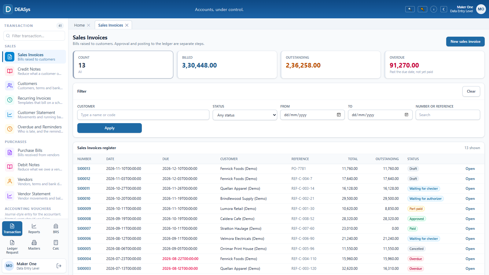
*Sales Invoices.*

### 2.3 Vouchers

Receipts, payments and contra vouchers have their own forms; journals and the other types use a line grid. See [section 7.1](#71-vouchers-the-basics).

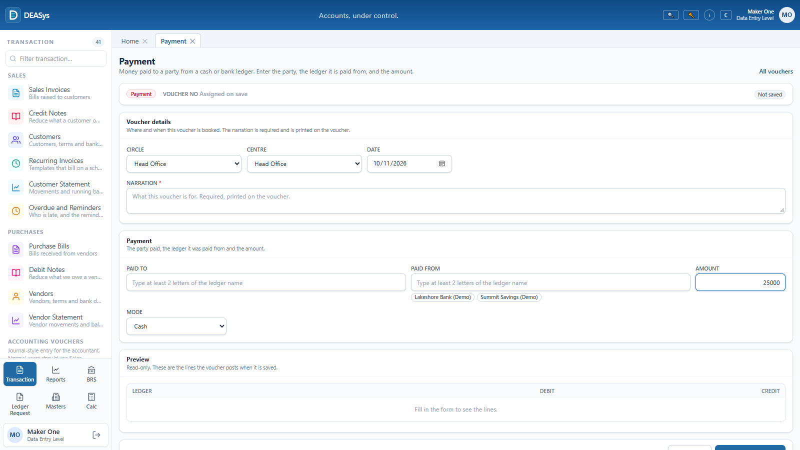
*A payment voucher.*

### 2.4 Approvals and My Task

Vouchers and invoices wait for the next person in the chain. **My Task** lists what waits for you.

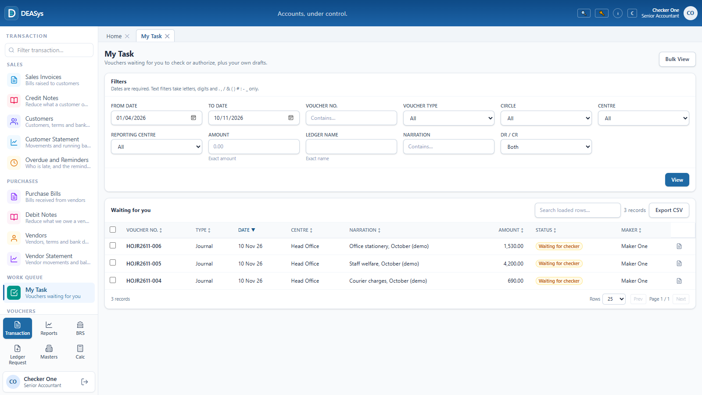
*My Task.*

### 2.5 Banking and reconciliation

Match the bank statement with the books (BRS), upload bank statement files and produce the NEFT file for payments.

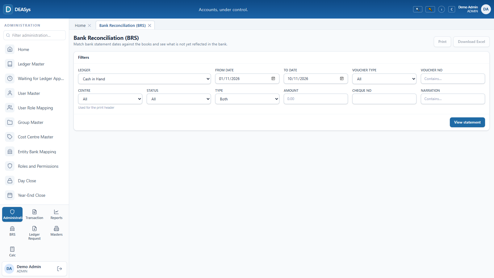
*Bank Reconciliation (BRS).*

### 2.6 GST

Set up your GSTINs, the state codes and the tax ledgers; keep HSN and SAC rates; check the GST returns, ITC and the 2A/2B reconciliation; prepare e-invoice and e-way bill data. See [section 8.1](#81-gst).

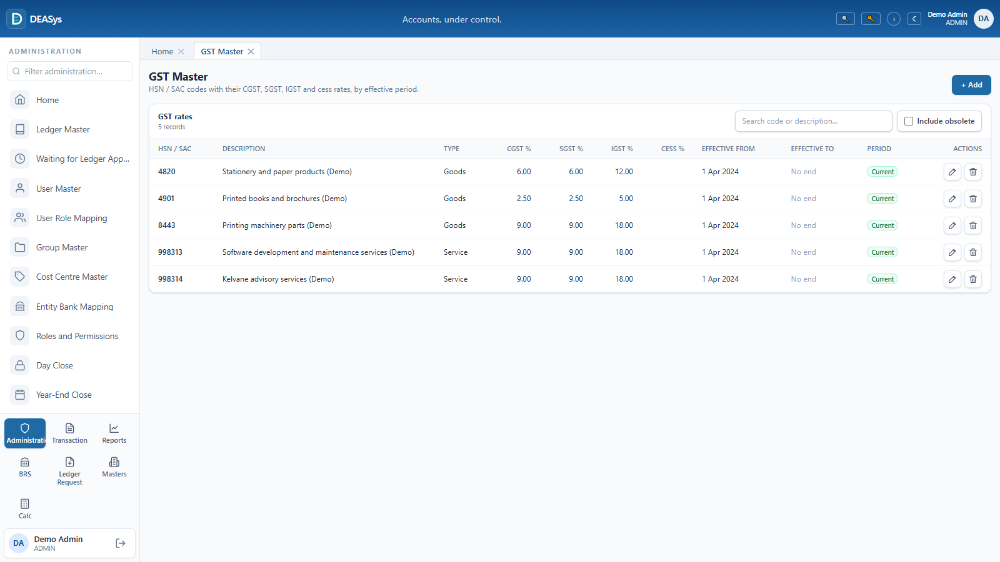
*HSN and SAC Rates.*

### 2.7 TDS and TCS

Set the TDS rates, parameters, deductor and deductee profiles; see the deductions, challans, return data, certificates and exceptions. See [section 8.2](#82-tds-and-tcs).

### 2.8 Reports

Trial balance, profit and loss, balance sheet, ageing, cost centre and budget reports, with drill-down, saved views and export. See [section 9](#9-reports).

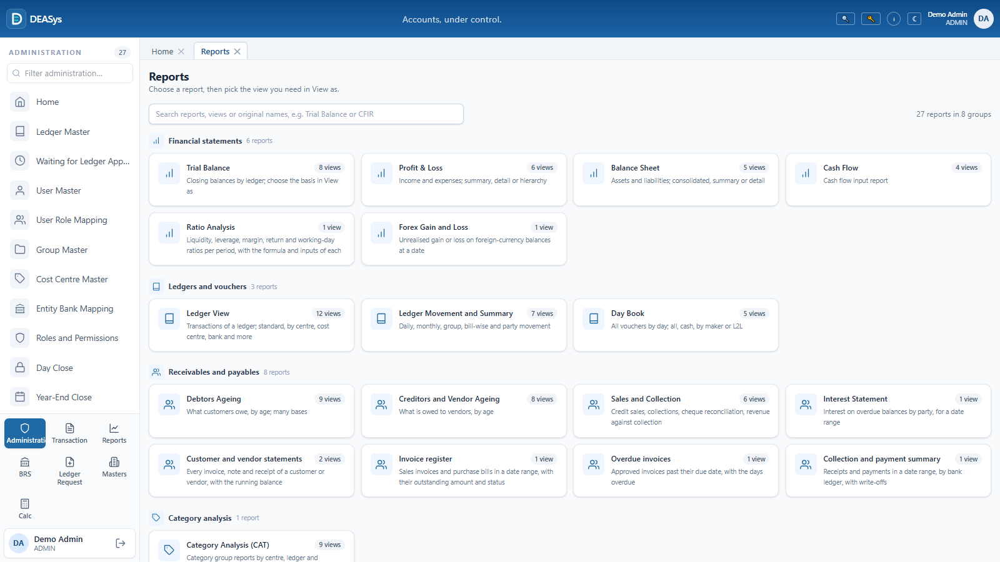
*The Reports menu.*

### 2.9 Audit trail

Changes to masters, vouchers, users and roles are written to the audit log, which can only be read.

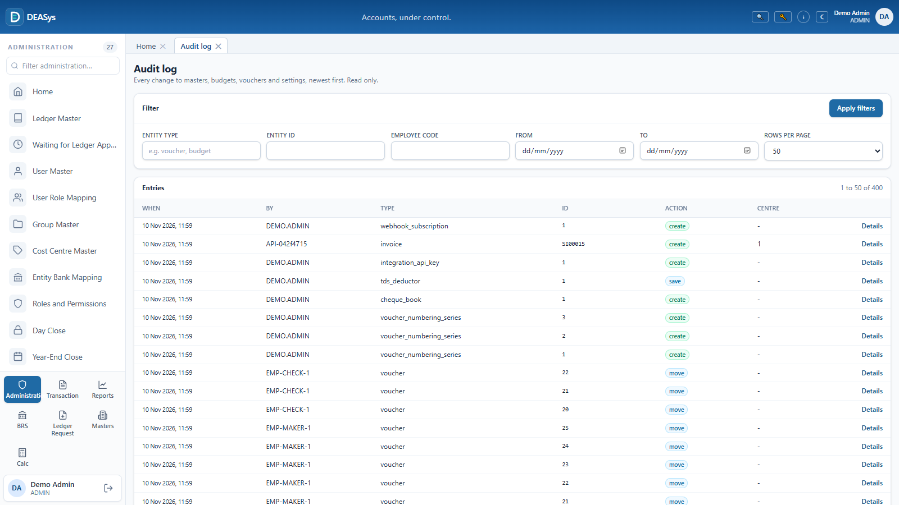
*Audit log.*

### 2.10 Roles and permissions

Each role is a set of permissions. You tick what each role may do, screen by screen.

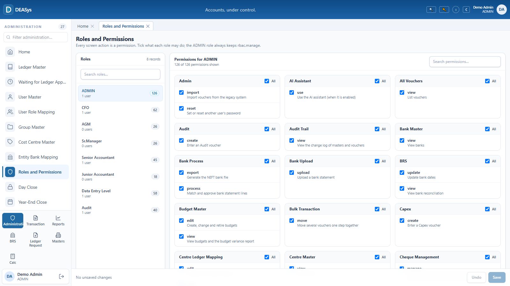
*Roles and Permissions.*

### 2.11 Integrations

An ERP, payroll system or other tool posts documents through an API key. DEASys records every message in an inbox and can send signed webhooks. The administration screens for keys, the inbox and webhooks are in the Administration section (see [section 11](#11-integrations)).

### 2.12 Day and year close

Close a day so nothing more posts to a centre on that date, and close a financial year once every voucher in it is authorized. See [section 8.4](#84-day-close-and-year-end-close).

---

## 3. System requirements and download

### 3.1 What you need

| Item | Requirement |
|---|---|
| Operating system | Windows 10 or Windows 11, 64-bit. Linux amd64 is also supplied (see section 4.7). |
| Database | The Windows installer sets up **its own PostgreSQL 16** (bundled). You can instead use an existing PostgreSQL server. |
| Memory and disk | Placeholder: see the release notes. The database grows with your vouchers and attachments. |
| Browser | A current version of Edge, Chrome or Firefox |
| Network | By default only this computer can open DEASys (`http://localhost:8080`). Other computers need the network option (section 4.4). |

### 3.2 What you download

| File | What it is |
|---|---|
| `DEASys-<version>-win64-setup.exe` | The Windows installer (the normal way to install). |
| `DEASys-<version>-win64.zip` | The same program as a zip, with `install.ps1`, for scripted or portable installs. |
| `deasys-server-linux-amd64` | The server for Linux. |
| `SHA256SUMS.txt` | The checksums of the files above. |
| `LICENSE.txt` | The licence. |

Installer images and steps are in section 4.

### 3.3 Check the download

Compare the file's checksum with the value in `SHA256SUMS.txt`. In PowerShell:

```powershell
Get-FileHash .\DEASys-0.1.0-win64-setup.exe -Algorithm SHA256
```

The hash must equal the value in `SHA256SUMS.txt` for that file. If it does not match, do not run the file.

The release may be unsigned. An unsigned build shows a Windows SmartScreen warning ("Windows protected your PC"). Choose **More info**, then **Run anyway**, only after you have checked the SHA-256.

---

## 4. Installation

### 4.1 Install with the installer (recommended)

1. Run `DEASys-<version>-win64-setup.exe` **as an administrator**. Accept the licence.
2. **Database.** Choose one of:
   - *Bundled PostgreSQL 16 (recommended)*: the installer installs PostgreSQL here. It listens on `127.0.0.1` only, on port **5433**.
   - *An existing PostgreSQL server*: you enter the connection details in a console window when the installer asks.
3. **Network access.** Leave the box empty to keep DEASys reachable only from this computer. Tick it to let other computers on a private network open DEASys on TCP port **8080**. The firewall rule covers private and domain networks only.
4. The program is copied to `C:\Program Files\DEASys`. The installer registers two Windows services, **DEASys** (the web server) and **DEASysDB** (the database), which start with Windows. It creates Start Menu and desktop shortcuts that open `http://localhost:8080`.
5. Finish. Open `http://localhost:8080` (or the shortcut) to create the company and the administrator (section 5).

Installer screens (captured when the release is built):

*Screenshot not included in this release: the Windows installer wizard is not available in this build (packaging is not in the repository), so there is no screen to capture.*
*The Windows installer, first page.*

*Screenshot not included in this release: the Windows installer wizard is not available in this build (packaging is not in the repository), so there is no screen to capture.*
*Installer options.*

The installer's own log is `C:\ProgramData\DEASys\logs\install.log`. It contains no passwords.

### 4.2 Files and folders the installer creates

| What | Where |
|---|---|
| Program | `C:\Program Files\DEASys` |
| Configuration | `C:\ProgramData\DEASys\deasys.conf` (holds the database connection and the sign-in key; keep it private) |
| Backups | `C:\ProgramData\DEASys\backups` (each upgrade backs up here first; contains every password hash) |
| Database superuser secret | `C:\ProgramData\DEASys\pgsuper.secret` (administrators only) |
| Logs | `C:\ProgramData\DEASys\logs`: `install.log` (installer), `deasys.log` (server, rotated), `postgres.log` (database) |

Keep `deasys.conf`, the backups and the superuser secret private. Only administrators and the service account can read them.

### 4.3 Install from the zip (scripted or portable)

Extract the whole zip, then either double-click **`Install DEASys.cmd`** (it asks Windows for permission and keeps the window open), or run `install.ps1` in an **elevated** PowerShell window from the extracted folder. The program file `deasys-server-windows-amd64.exe` on its own is not the installer: it needs a PostgreSQL database, and `INSTALL.md` has the steps to create one and the complete connection string.

Manual way:

```powershell
.\install.ps1                      # bundled PostgreSQL, local access only
.\install.ps1 -AllowNetwork        # also open TCP 8080 on private networks
.\install.ps1 -DbMode existing     # use an existing PostgreSQL server
```

Useful options: `-InstallDir`, `-DataDir`, `-AppPort` (default 8080), `-PgPort` (default 5433), `-NoShortcuts`, `-NoService`, `-NoBrowser`. `-Portable` is a test mode without service, firewall or shortcuts; it does not need administrator rights. The script is the same one the installer runs.

### 4.4 Network access

By default DEASys listens for local use only. To let other computers open it on a private network, use the installer option (section 4.1, ((((step 7))))) or run `install.ps1 -AllowNetwork` again elevated. **Do not expose DEASys to the internet without a TLS proxy in front of it** (section 10.6).

### 4.5 Upgrade

Run the new installer (or `install.ps1` from the new zip) over the existing installation. Your data is kept.

- The database is backed up first, into `C:\ProgramData\DEASys\backups`.
- If the new version does not start, the previous program files and database are put back automatically.
- Keep `deasys.conf`: it holds the database connection and the sign-in key.

See the release notes for the version's changes.

### 4.6 Uninstall

Use **Settings > Apps > DEASys > Uninstall**, or run `C:\Program Files\DEASys\uninstall.ps1` from an elevated PowerShell.

- Services, shortcuts and the firewall rule are removed. Your data and backups are **kept**.
- To delete the data too, run `uninstall.ps1 -RemoveData` and type the confirmation phrase **DELETE DEASYS DATA** when asked. Nothing is deleted without it.

### 4.7 Linux

The Linux build is the server program only. Run it under systemd with the unit file in the release (`deploy/linux`). The suggested folders are `/usr/local/bin/deasys-server`, `/etc/deasys/deasys.conf` (mode 0600, owned by the service user), `/var/log/deasys/` and `/usr/local/share/deasys/ui/`. The log goes to `log_dir` and to the journal.

### 4.8 Running from a console (trial only)

```powershell
cd "C:\Program Files\DEASys"
.\deasys-server.exe run
```

The server runs until you press Ctrl+C. Do not use a console window for daily work.

### 4.9 The configuration file

Settings come from `deasys.conf` and from environment variables. **An environment variable wins over the file.** An unknown key in the file is an error, so a typing mistake is never ignored. Check the effective values with `deasys-server.exe config show` (secrets are masked).

*Screenshot not included in this release: terminal capture: needs a real PowerShell or Command Prompt window; this script does not drive a terminal, and the output is not faked.*
*The effective settings (`config show`).*

| File key | Default | Meaning |
|---|---|---|
| `database_url` | set by the installer | The database connection. Secret. |
| `listen_addr` | `127.0.0.1:8080` | Address and port. Leave on loopback unless a TLS proxy is in front. |
| `jwt_key` | set by the installer | The key that signs sign-in tokens. Secret. |
| `log_dir` | `%ProgramData%\DEASys\logs` | The folder for `deasys.log`. |
| `auto_migrate` | `on` | Apply database changes when the server starts. |
| `pg_bin` | none (uses PATH) | The folder with `pg_dump` and `pg_restore`. |
| `public_url` | none | The address users open DEASys at. Information only. |
| `ui_dir` | none | A folder with a newer web interface (section 10.5). |

### 4.10 Windows services

`deasys-server.exe service status` shows the service state. The installer registers `DEASys` and `DEASysDB`. Both need an elevated PowerShell to start, stop or change.

*Screenshot not included in this release: terminal capture: needs a real PowerShell or Command Prompt window; this script does not drive a terminal, and the output is not faked.*
*Service status.*

---

## 5. First start (bootstrapping)

"Bootstrapping" means creating the first company, the first branch and the first administrator, starting from an empty database. You do it once.

### 5.1 Before you start

- DEASys is installed and running (section 4). The server reports that no user exists.
- Nobody has signed in yet. The first-run wizard closes for good after the first administrator is created.

### 5.2 Run the first-run wizard

1. Open `http://localhost:8080` in a browser.
2. While no user exists, the **first-run wizard** appears before the sign-in page. It has seven steps shown with a progress bar: **Welcome**, **Terms and conditions**, **Organisation**, **First branch**, **Administrator**, **Financial year and currency**, **Review**.
3. Use **Next** to move forward and **Back** to change an answer. Nothing is saved until you press **Create** on the last step.
4. The same terms are accepted by the other two ways to set up DEASys: the Windows installer's I accept button (or the `-AcceptTerms` switch of `windowsinstall.ps1` for an unattended install, which refuses to run without it), and `deasys-server init-admin --accept-terms` on the command line.

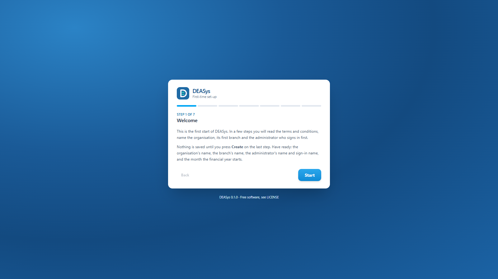
*Step 1: Welcome.*

**Step 3: Organisation.** Enter the **Organisation name** (for example Harbor Pine Trading Co.). It is printed on invoices and reports.

**Step 2: Terms and conditions.*

**Optional: tell the author.** DEASys sends nothing about you or your data anywhere. The only exception is an optional box on this step, shown only when the operator has set `registration_url` (an https address) in `deasys.conf`. It is never ticked for you. If you tick it, one message is sent once, when the set-up is created, with only the product name, version, operating system, date and a contact e-mail if you type one. Leave it unticked and DEASys works the same. See section 5 of the terms.* Read the terms and conditions to the end, or press **I have read it**, then tick **I have read and accept the terms and conditions**. The set-up cannot go on until you accept them.

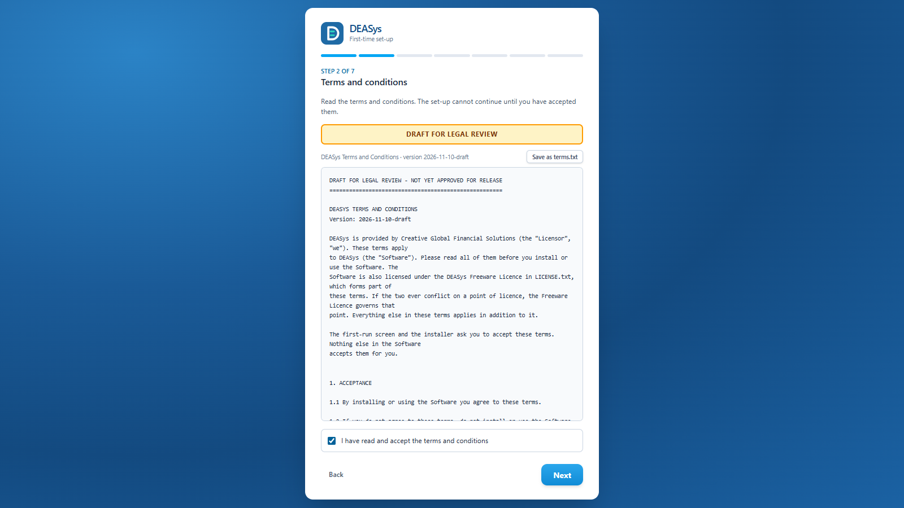
*Step 2: Terms and conditions.*

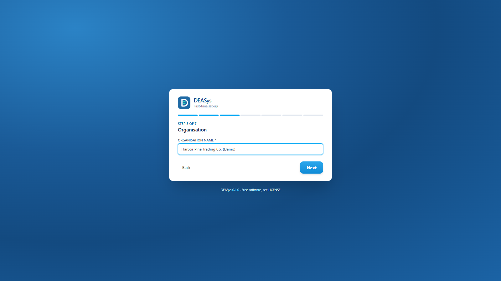
*Step 3: Organisation.*

**Step 4: First branch.** Enter the **Branch name** (for example Head Office). The wizard calls this the first branch; it becomes the first centre. You can add branches later (section 6.2).

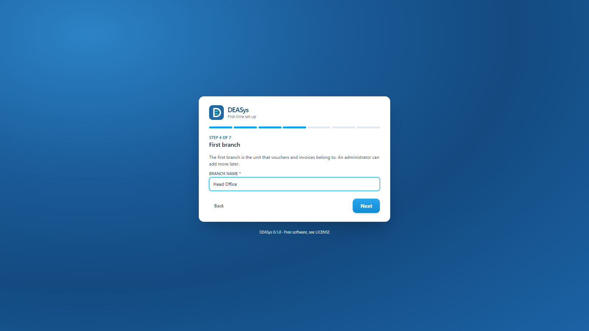
*Step 4: First branch.*

**Step 5: Administrator.** Enter:

| Field | Meaning | Rules |
|---|---|---|
| Full name | The administrator's name, shown on vouchers and in the audit log. | Required; at most 110 characters. |
| Sign-in name | The login name. | Required; at most 30 characters. |
| Password and Confirm password | The password. | Required. The rules list ticks as each is met. |

Password rules: at least 10 characters, with a letter and a digit, not repetitive, not common, and not containing the sign-in name or the employee code.

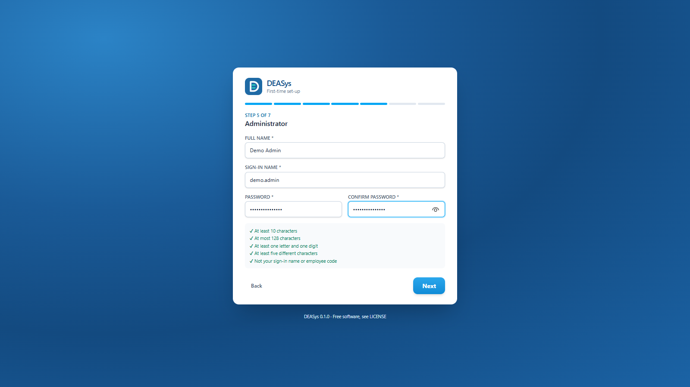
*Step 5: Administrator and password rules.*

**Step 6: Financial year and currency.** Choose **Financial year starts in** (the month, default April) and the **Base currency** (default INR).

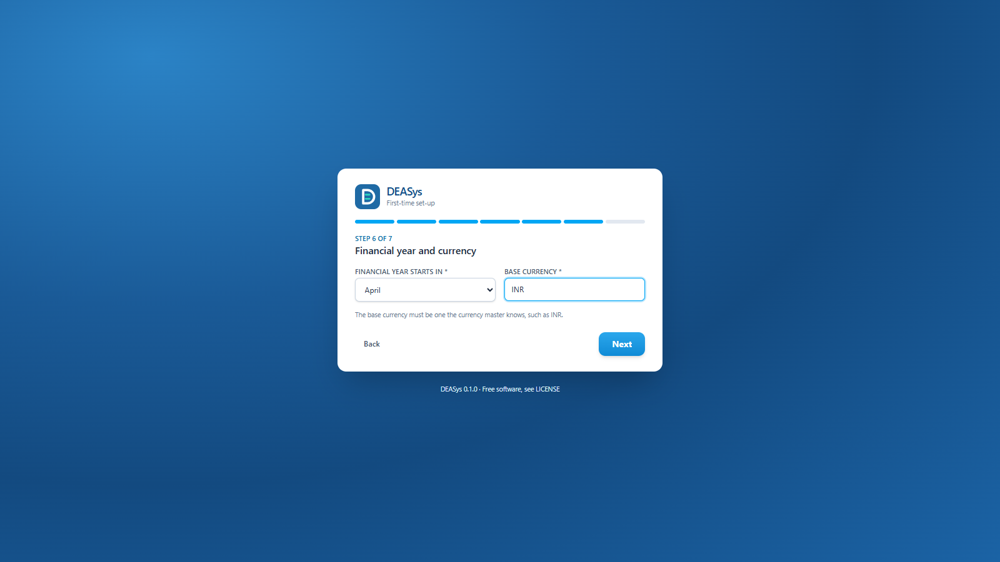
*Step 6: Financial year and currency.*

**Step 7: Review.** Check the answers and press **Create**. If a value is wrong, the wizard opens the step with the problem.

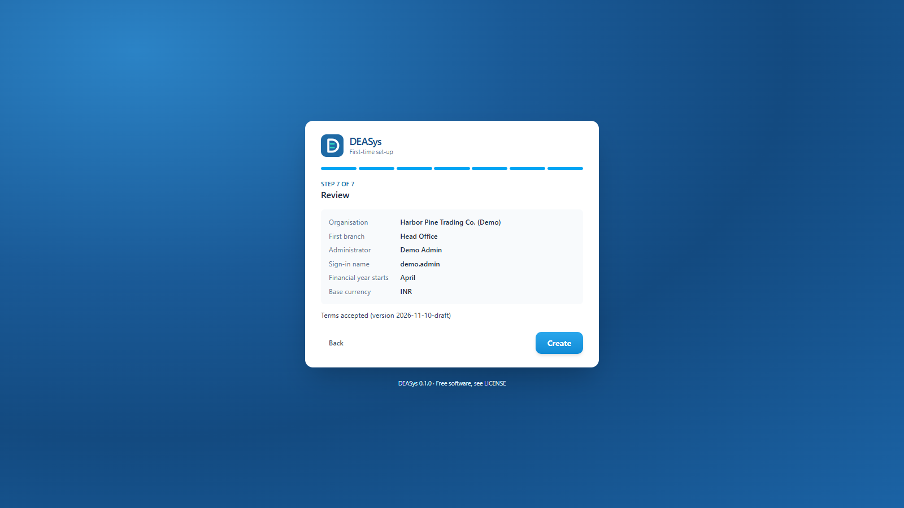
*Step 7: Review and Create.*

**What the first run creates, in one transaction.** The company; the first branch (a circle and a centre with it); the administrator with the ADMIN role, which holds every permission; the current financial year; the financial-year and base-currency settings; and an audit entry. If any step fails, all of it is rolled back and you can try again.

The first-run step answers 409 after the first administrator exists, for every caller. It is limited to five attempts from one address in 15 minutes (429).

### 5.3 The command-line alternative

The same first run can be done from a console:

```powershell
cd "C:\Program Files\DEASys"
.\deasys-server.exe init-admin
```

It asks the same questions in the same order (organisation name, branch name, administrator name, sign-in name, password typed twice, financial-year start month, base currency).

*Screenshot not included in this release: terminal capture: needs a real PowerShell or Command Prompt window; this script does not drive a terminal, and the output is not faked.*
*The `init-admin` prompts.*

### 5.4 Sign in for the first time

1. Open `http://localhost:8080`. Once users exist, the sign-in page is shown.
2. Enter the **User Name** and the **Password**, then click **Login ▸**.


*The sign-in page.*

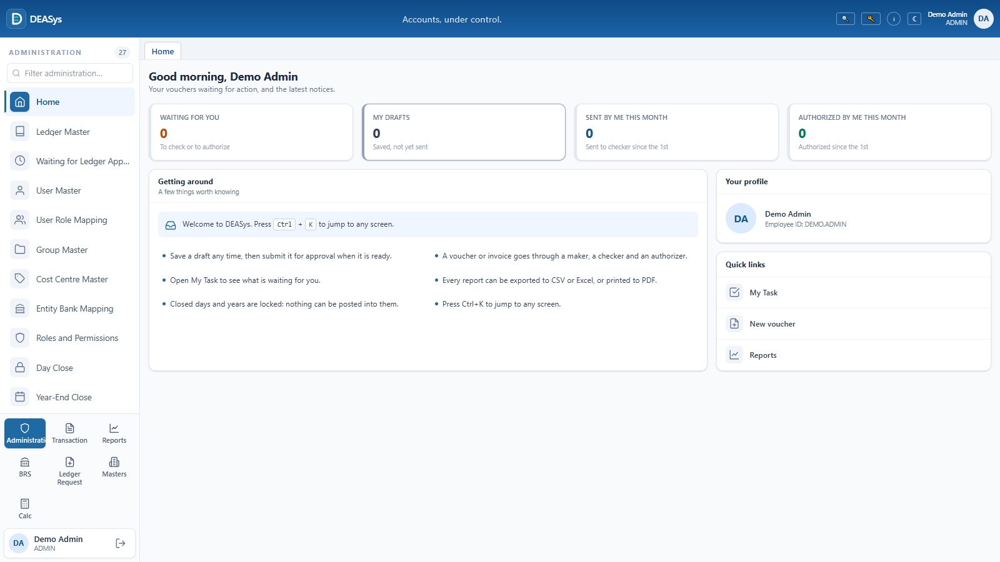
*Home after the first sign-in. The left menu shows the Administration section.*

### 5.5 Change your password

Click the key button (**Change password**) in the top bar, or open `/change-password`. Enter **Current password**, **New password** and **Repeat new password**.

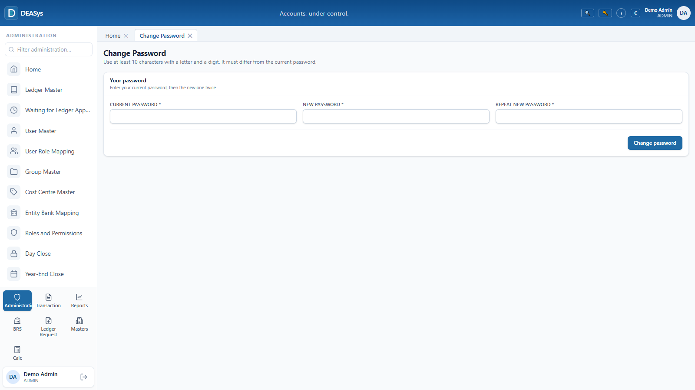
*Change password.*

Change the administrator's password after the first sign-in, then create the other users (section 6.5).

### 5.6 The top bar

From left to right: the search button (**Ctrl+K** opens **Go to…**, which finds any screen by name), the key button (change password), the **Ask DEASys** button (shown only when the server enables the assistant, which is not the case in this release), the (i) button (About), the moon or sun button (dark mode), and your name and role.

---

## 6. Setting up the system, in order

Work through this checklist once, in order. Each step names the menu path. The left menu has a **Next steps** page (`/next-steps`) with the same list, but in this release it is reached by its address, not from the menu. The sections are: **Transaction**, **Reports**, **BRS**, **Ledger Request**, **Masters**, **Calc**, and **Administration** (for an administrator).

| # | Step | Menu path | Who |
|---|---|---|---|
| 1 | Organisation and invoice settings | Transaction > Invoice Settings | Admin |
| 2 | Branches (centres) | Masters > Centre Master | Admin |
| 3 | Chart of accounts: groups and ledgers | Administration > Group Master, Ledger Master | Admin (the accountant requests ledgers) |
| 4 | Financial year and periods | Administration > Year-End Close, Day Close | Admin |
| 5 | Users | Administration > User Master | Admin |
| 6 | Roles and permissions | Administration > Roles and Permissions | Admin |
| 7 | Assign roles to users | Administration > User Role Mapping | Admin |
| 8 | Voucher numbering | Administration > Numbering series | Admin |
| 9 | Bank accounts and entity-bank mapping | Masters > Bank Master; Administration > Entity Bank Mapping | Admin |
| 10 | Customers and vendors | Transaction > Customers, Vendors | Accountant |
| 11 | Cost centres and budgets | Administration > Cost categories, Cost centres, Budgets | Admin |
| 12 | Currencies and exchange rates | Administration > Currencies and exchange rates | Admin |
| 13 | GST: setup, GSTIN, states, tax ledgers, HSN and SAC rates | Transaction > GST (section 6.13) | Admin |
| 14 | TDS and TCS: rates, parameters, deductor, deductee profiles | Administration > Tax (TDS and TCS) (section 6.14) | Admin |
| 15 | Cheque books | BRS > Cheque books | Accountant |
| 16 | Integrations: keys, inbox, webhooks | Administration > Integrations (section 11) | Admin |

### 6.1 Organisation and invoice settings

Menu: **Transaction > Invoice Settings** (`/invoice-settings`). This screen holds the company block printed on invoices (name, address, GSTIN), the write-off threshold and ledger, the ledger categories for new customer and vendor ledgers, the reminder letter template, the posting mode and the numbering of each invoice series.

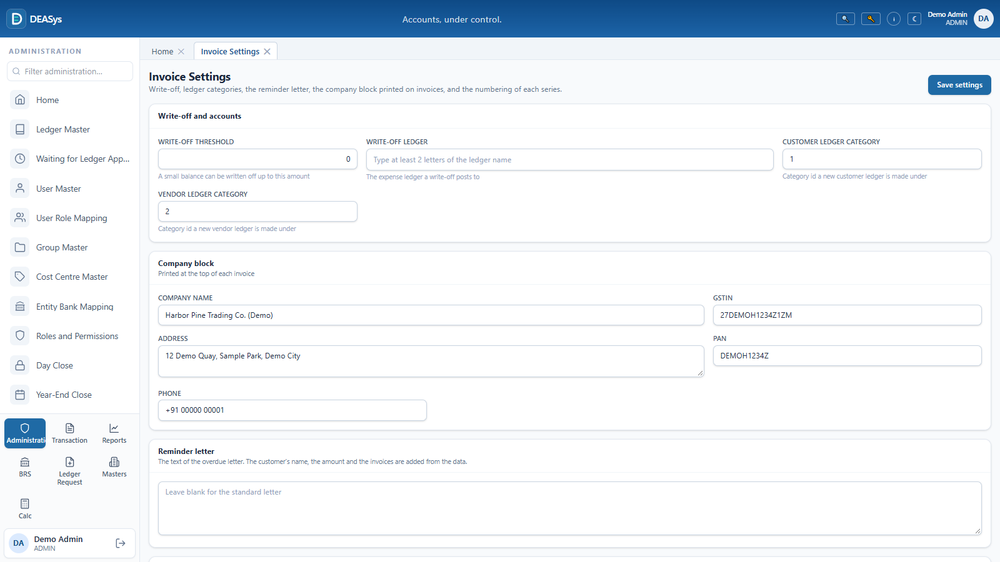
*Invoice Settings.*

| Field | Meaning | Rules |
|---|---|---|
| Company GSTIN | The company's GST registration number, printed on invoices. | Use your real GSTIN. The registrations screen (section 6.13) holds one GSTIN per branch and period. |
| Write-off threshold | The largest amount that can be written off against an invoice. | Zero until set. A write-off needs a reason. |
| Posting mode | When an approved invoice is posted to the ledger. | Manual (default): a separate step. "On approval": posting happens with approval. |

### 6.2 Branches (centres)

Menu: **Masters > Centre Master** (`/masters/centres`). The list shows the centres of the company. In this release the list is **read only**: the first branch is created by the first-run wizard, and more branches are not yet added in the screen (see [open issues](docs/guide-open-issues.md)).

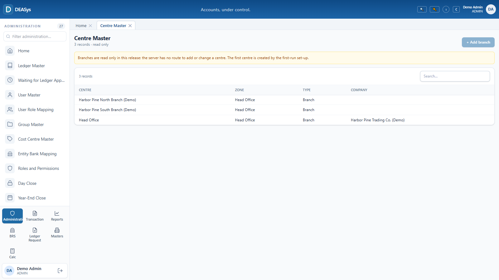
*Centre Master (read only).*

The **Masters** section (`/masters`) lists the master screens: Centre Master, Bank Master and Centre Ledger Mapping.

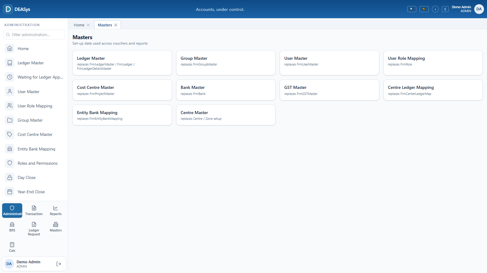
*Masters.*

### 6.3 Chart of accounts: groups and ledgers

The product ships with a neutral chart of accounts of 23 groups: capital, loans, current liabilities, fixed and current assets (including Cash & Bank Balances with its children), income and expenses.

**Groups.** Menu: **Administration > Group Master** (`/masters/groups`). A group has a name, a nature (asset, liability, income or expense) and a parent.

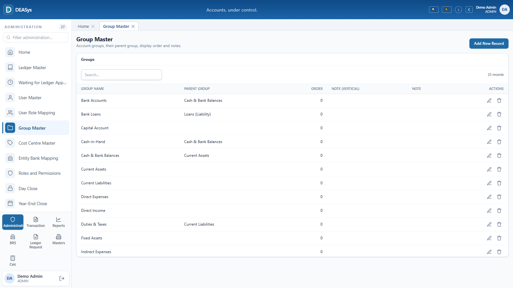
*Group Master.*

**Ledgers.** Menu: **Administration > Ledger Master** (`/masters/ledgers`). Each ledger shows its group, category, whether it is bill-wise, and its status. Search by name.

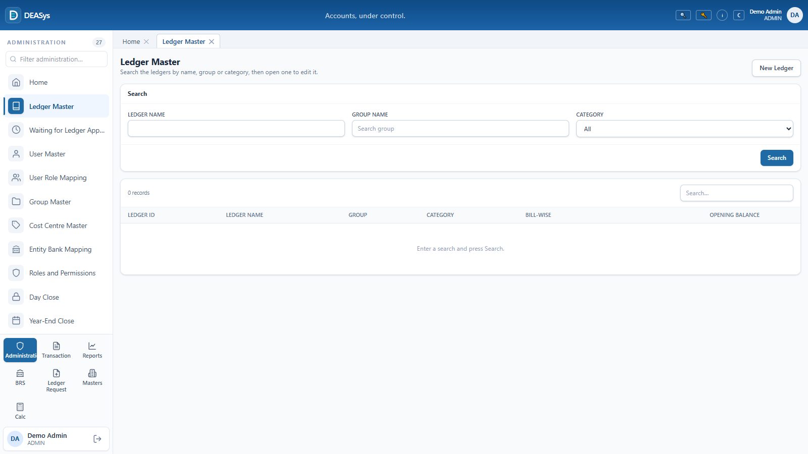
*Ledger Master.*

**Adding a ledger.** An accountant asks for a ledger; an administrator approves it.

1. Menu: **Ledger Request > New Ledger Request** (`/ledger-request/new`). Fill in the form and submit.
2. Track it in **Ledger Request > My Ledger Requests** (`/my-ledger-requests`).
3. The administrator opens **Administration > Waiting for Ledger Approval** (`/ledger-approvals`) and approves or rejects it.

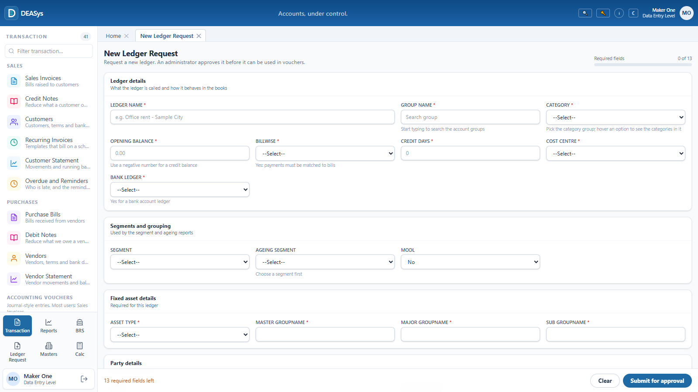
*New Ledger Request.*

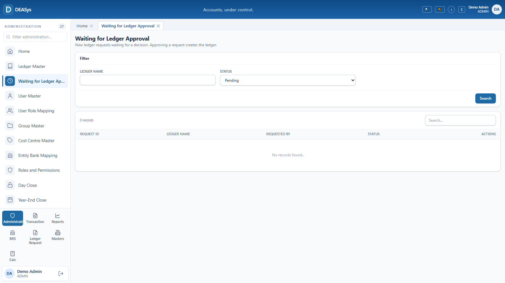
*Waiting for Ledger Approval.*

| Field | Meaning | Rules |
|---|---|---|
| Ledger name | The name in the books. | Unique within the company. |
| Group | The group the ledger sits under. | Choose from the list. |
| Bill-wise | Whether the ledger tracks each bill (customer and vendor ledgers are bill-wise). | Set on the ledger. |

> **Opening balances.** This release has no dedicated opening-balance screen. Confirm the method with your administrator before live use (see [open issues](docs/guide-open-issues.md)).

### 6.4 Financial year and periods

Menu: **Administration > Year-End Close** (`/period/year`) and **Administration > Day Close** (`/period/day`).

The financial year starts on the month you set in the wizard (default April). The Year-End Close screen lists the financial years. A year closes only after it has ended and every voucher in it is authorized: the **Close year** button is disabled while a voucher is still pending, and the message says "Authorize or delete the pending vouchers first".

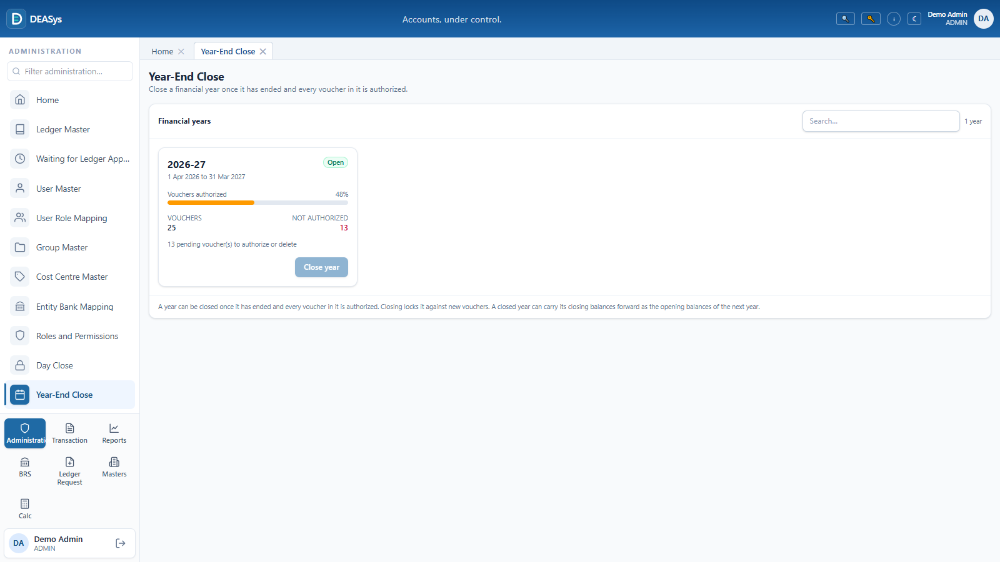
*Year-End Close: the financial years.*

Day Close and the carry-forward are in [section 8.4](#84-day-close-and-year-end-close).

### 6.5 Users

Menu: **Administration > User Master** (`/masters/users`). Administrators create and maintain the people who can sign in: login, name, employee code, centre and status (Active or Inactive).

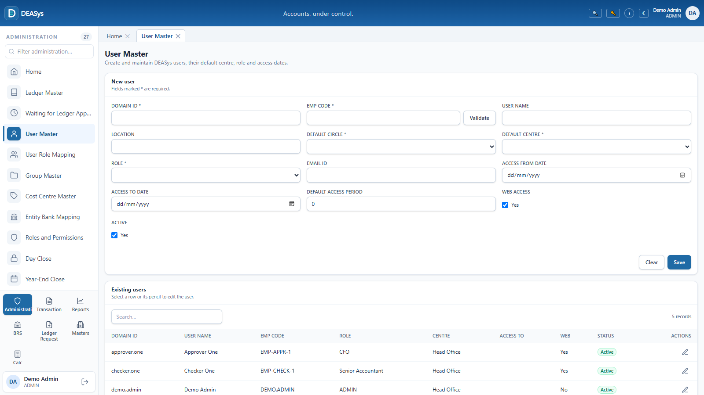
*User Master.*

| Field | Meaning | Rules |
|---|---|---|
| Login | The sign-in name. | Unique. |
| Name | The person's full name. | Shown on vouchers and in the audit log. |
| Emp code | The employee code. | Used in the audit log and in integrations. |
| Centre | The default centre of the user. | Choose from the list. |
| Status | Active or Inactive. | An inactive user cannot sign in. |

Create a user, give the user a role ((step 7).7), and ask the user to change the starting password at the first sign-in.

### 6.6 Roles and permissions

Menu: **Administration > Roles and Permissions** (`/rbac`). Every screen action is a permission. You tick what each role may do. The ADMIN role always keeps the permission to manage roles, so the administrator cannot lock everyone out.

The product ships with eight roles: **ADMIN**, **CFO**, **AGM**, **Sr.Manager**, **Senior Accountant**, **Junior Accountant**, **Data Entry Level** and **Audit**. The ADMIN role holds every permission.


*Roles and Permissions.*

Two rules matter for approvals:

- A person cannot check or authorize a voucher they made, and cannot approve an invoice they made or checked.
- Posting an invoice or a receipt also needs the **create** permission of its voucher type (for example `voucher.create.sales`).

### 6.7 Assign roles to users

Menu: **Administration > User Role Mapping** (`/masters/roles`). Each user is given one role. The screen shows which role each user holds.

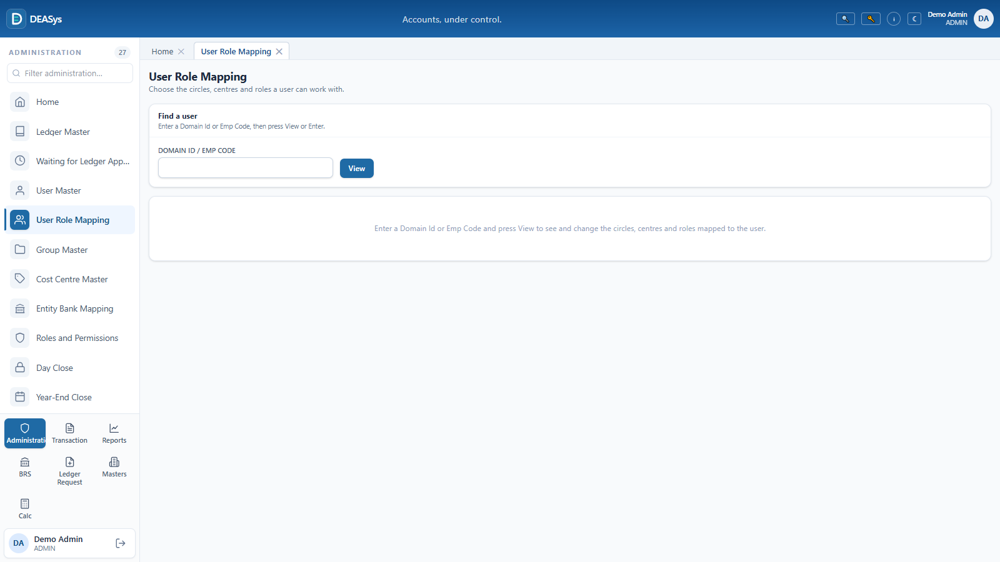
*User Role Mapping.*

### 6.8 Voucher numbering

Menu: **Administration > Numbering series** (`/numbering`). Each voucher type numbers its vouchers from a series. A series sets:

| Setting | Meaning | Example |
|---|---|---|
| Voucher type | The type the series applies to. | Receipt |
| Centre | One centre, or all centres. | All centres |
| Numbering method | `automatic` (prefix, counter and suffix), `manual` (you type the number on submit; it must be unique), or `none` (no number). | automatic |
| Prefix and suffix | Text before and after the counter. | `RE` and `/` |
| Start number and padding | The first counter value and the number of digits. | 1, padded to 5 |
| Restart each year | Start the counter again each financial year. | on |

If no series exists for a type, the legacy rule applies: the centre's call name, the type's alias, the year and month, and a counter.

Invoices have their own numbering on **Invoice Settings** (section 6.1). Changing the next number can create duplicates, so check the register first.

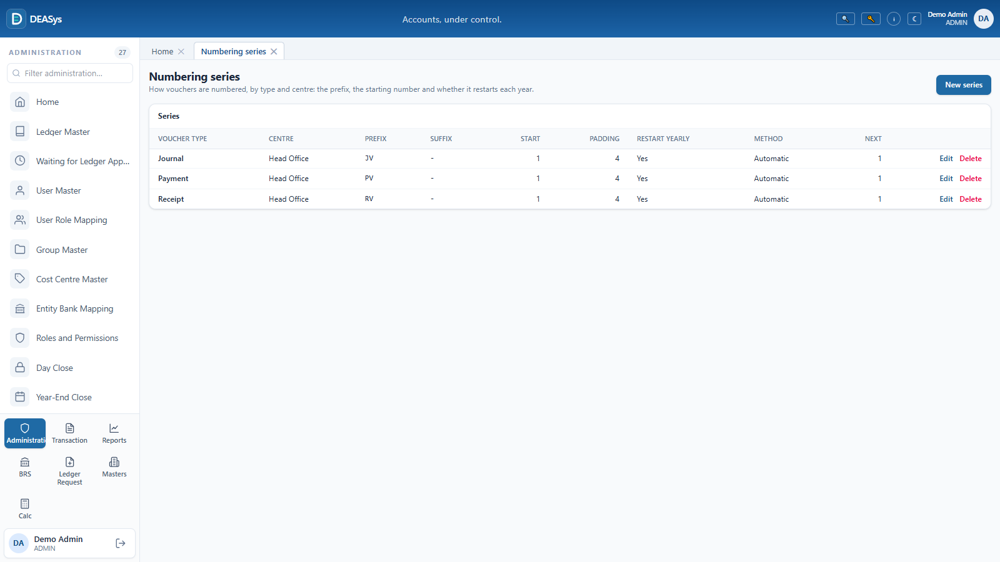
*Numbering series.*

### 6.9 Bank accounts and entity-bank mapping

The **Bank Master** lists the banks, their branches, IFSC codes, accounts and ledgers (menu **Masters > Bank Master**, `/masters/banks`). The **Entity Bank Mapping** (menu **Administration > Entity Bank Mapping**, `/masters/entity-bank`) says which bank account a centre uses for which purpose, for example payments.

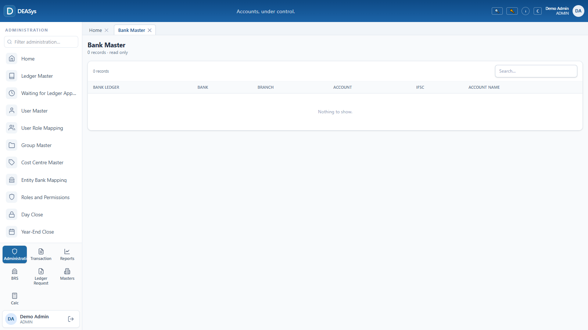
*Bank Master.*

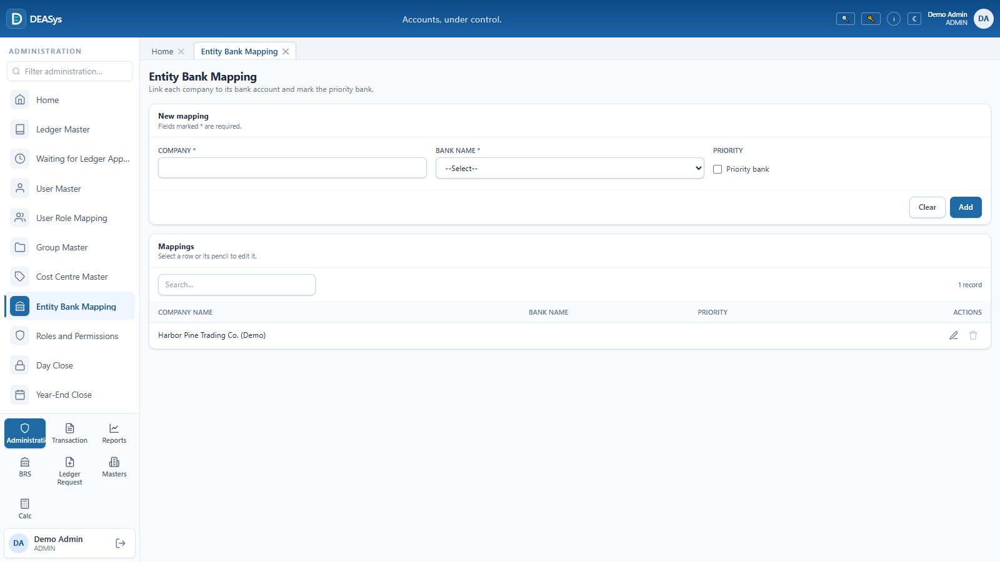
*Entity Bank Mapping.*

### 6.10 Customers and vendors

Menu: **Transaction > Customers** (`/sales/customers`) and **Transaction > Vendors** (`/purchases/vendors`). Use **New customer** (or the vendor equivalent) to add one.

A party is a customer, a vendor or both. Each role has its own bill-wise ledger in Sundry Debtors (customers) or Sundry Creditors (vendors). A party that is both gets a second ledger named `<name> (Payable)`. Addresses, state, pincode, payment terms, bank details and GST details are copied to each invoice when it is created and can be changed on the invoice.

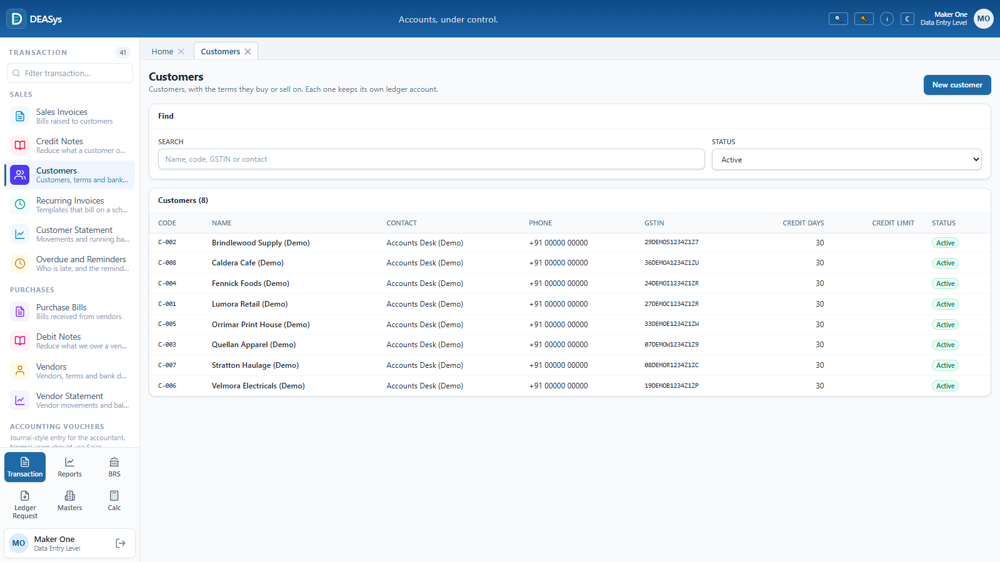
*Customers.*

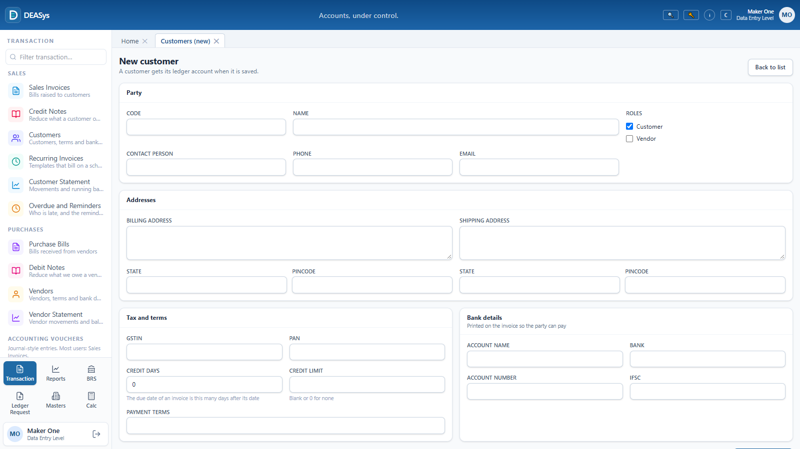
*New customer.*

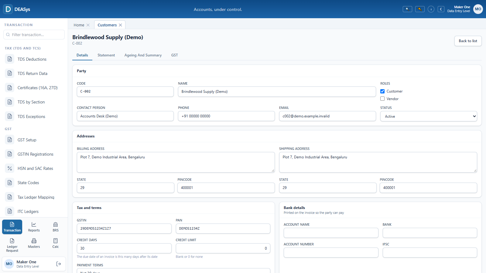
*The GST tab of a customer: GSTIN, registration type and place of supply.*

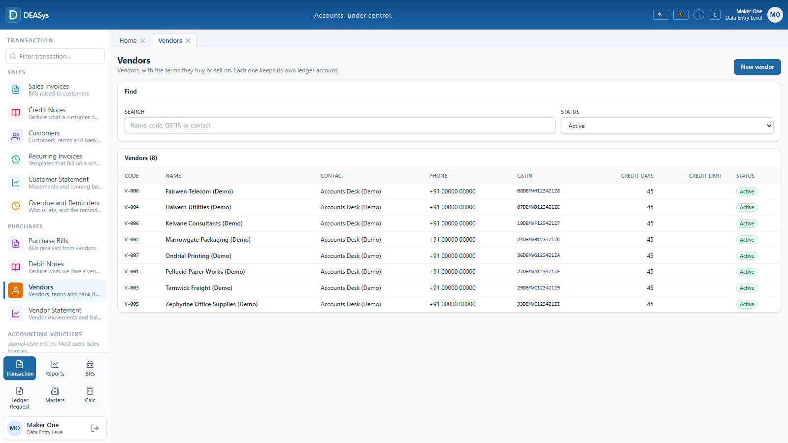
*Vendors.*

A party with invoices waiting for approval, or with unpaid invoices, cannot be deleted. Deleting a party makes it obsolete instead.

### 6.11 Cost centres and budgets

Cost centres track income and expense across branches or projects.

1. **Administration > Cost categories** (`/cost/categories`): the groups for cost centres. A category can have a parent.
2. **Administration > Cost centres** (`/cost/centres`): the cost centres, with code, name and category.
3. **Administration > Cost Centre Master** (`/masters/projects`): the older single-level cost centre list.
4. **Administration > Budgets** (`/cost/budgets`): planned amounts per ledger or group, optionally per cost centre, either monthly (twelve April-to-March amounts) or annual.
5. **Administration > Credit and budget controls** (`/cost/controls`): for a ledger or group, choose what happens when a voucher goes over: **ignore**, **warn** or **block**. A block refuses the voucher; a warning lets it through and shows the warning.

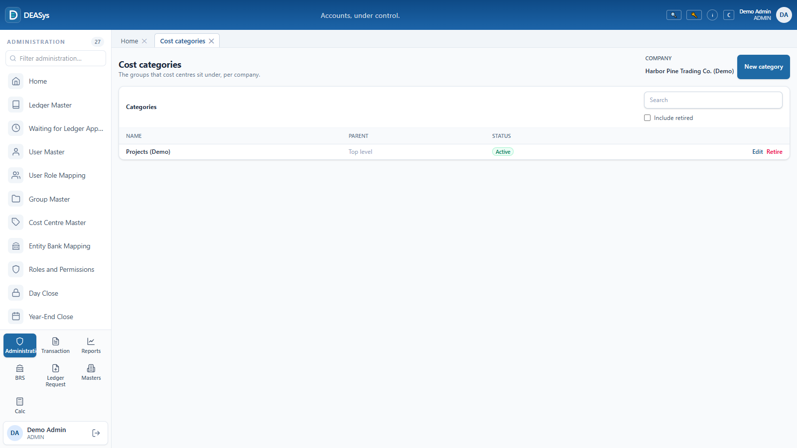
*Cost categories.*

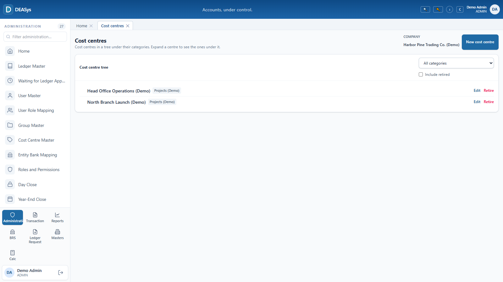
*Cost centres.*

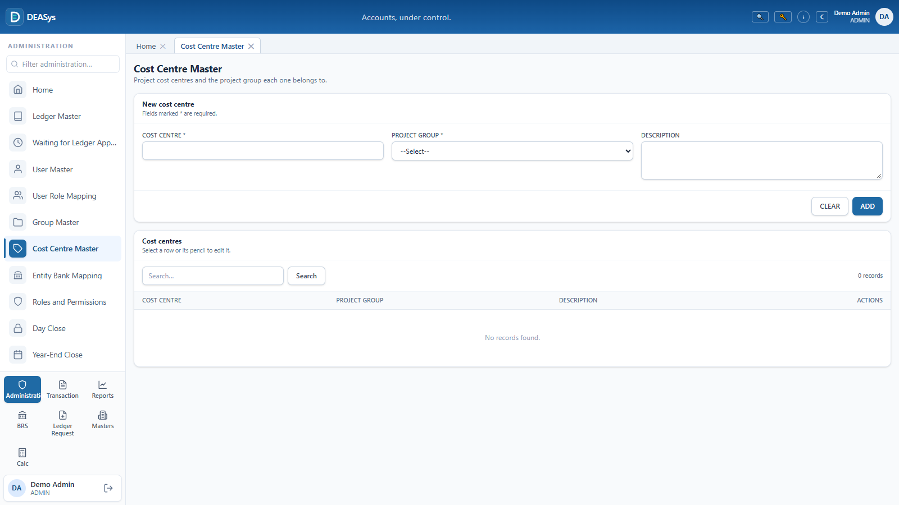
*Cost Centre Master (the single-level list).*

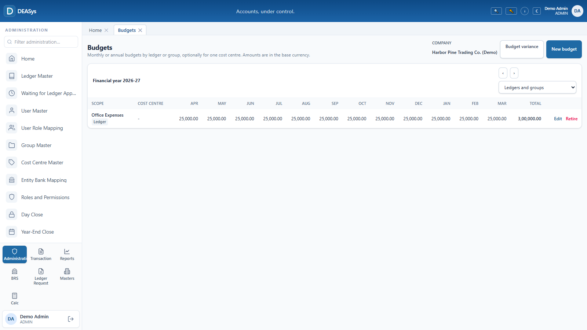
*Budgets.*

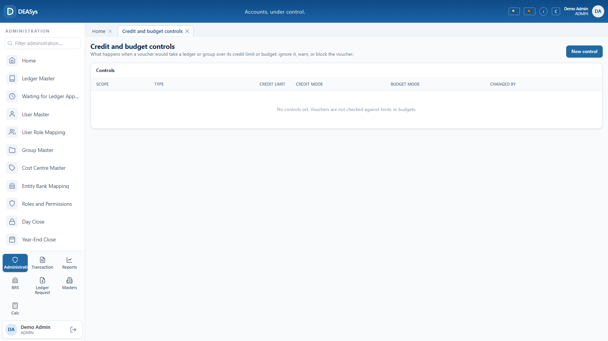
*Credit and budget controls.*

When you enter a voucher line you can split it across cost centres in the cost split dialog. The split amounts must add up to the line amount.

### 6.12 Currencies and exchange rates

Menu: **Administration > Currencies and exchange rates** (`/currency`). The base currency is INR (set in the wizard). Add the foreign currencies you deal in, and enter their exchange rates by date.

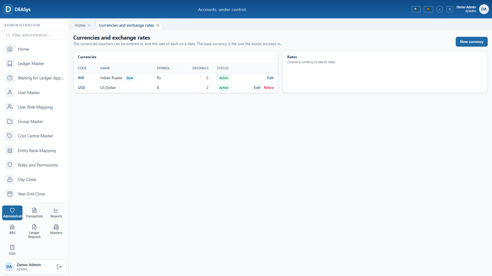
*Currencies and exchange rates.*

Foreign-currency vouchers carry the currency, the exchange rate and the foreign amount on each line; the base amount is the foreign amount times the rate, rounded to 2 places. A foreign-currency voucher cannot yet be an inter-branch voucher.

### 6.13 GST setup

The GST menu group is in the **Transaction** section, below the invoicing items. Set it up in this order. Each screen needs the `gst.*` permission for what it does.

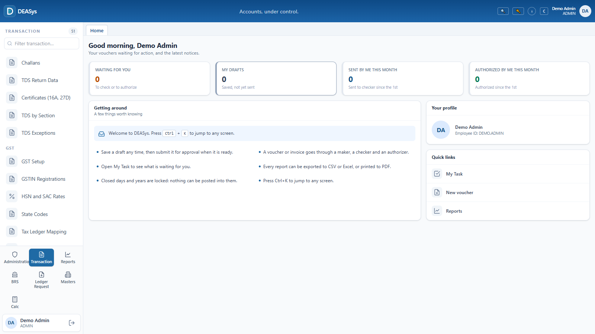
*The GST group in the Transaction menu.*

**Step 1. Turn GST on: GST Setup** (`/gst/setup`, menu **GST > GST Setup**).

1. Tick **GST is on for this company**.
2. Choose the **round-off** rule (round the invoice total to the rupee, or not).
3. Check the **parameters** table: the values the tax engine reads by code (for example thresholds and limits). Each has an effective period. A period cannot overlap a value already stored for the same code. Use **Save parameter** to add one.
4. Press **Save**.

When GST is on, invoices and bills take HSN or SAC codes, the tax comes from the rate master, and the GST returns and e-invoice screens are used.

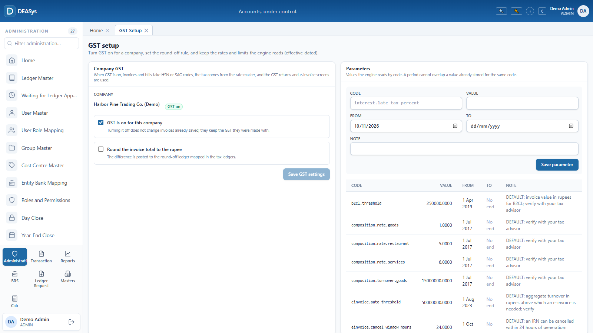
*GST setup.*

**Step 2. Registrations: GSTIN Registrations** (`/gst/registrations`).

Add each GSTIN of the company and its branches, each with the period it is valid for. Invoices keep the registration they were made with.

| Field | Meaning | Rules |
|---|---|---|
| Branch | The branch the registration belongs to, or **Company (all branches)**. | Choose from the list. |
| GSTIN | The 15-character registration number. | Taken from the first two digits for the state. |
| Legal name and Trade name | As registered. | |
| Address, Pincode, State | The principal place of business. | State is chosen from the state codes. |
| Registration type | The type of registration. | Choose from the list. |
| Effective from and Effective to | The period. | **No end** keeps it live. |

Registrations are retired, not deleted, when they end.

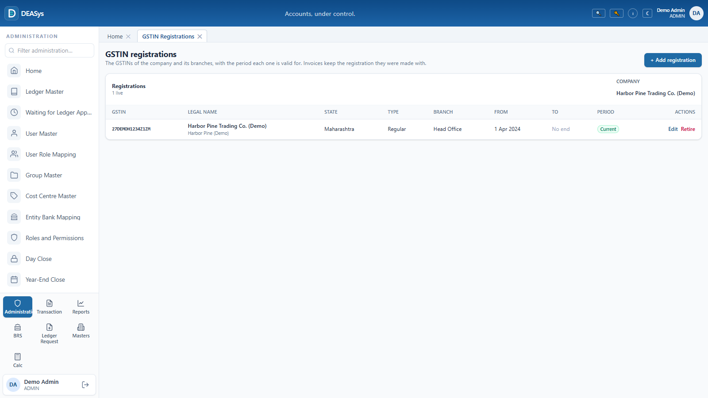
*GSTIN registrations.*

**Step 3. States: State Codes** (`/gst/states`, read only). The state table the GSTIN, the place of supply and the returns read. It is seeded data.

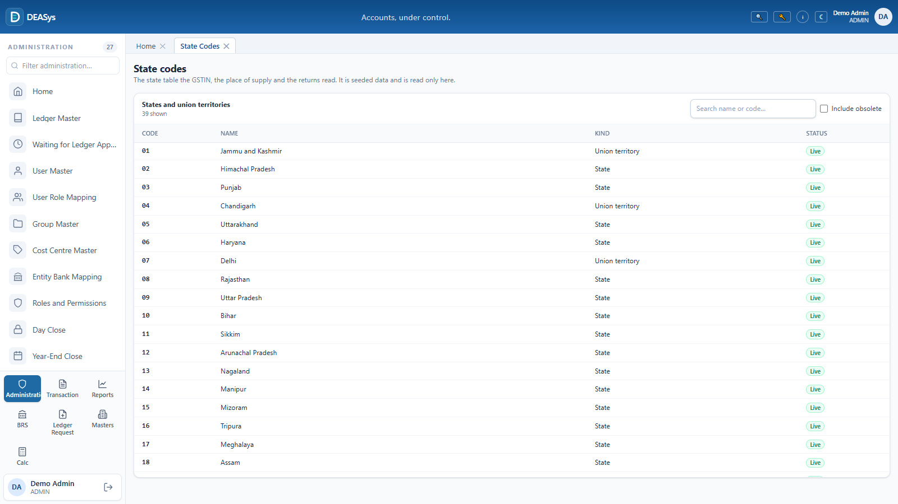
*State codes.*

**Step 4. Tax ledgers: Tax Ledger Mapping** (`/gst/tax-ledgers`).

The ledger each tax amount posts to, by tax head (IGST, CGST, SGST, UTGST, cess) and side, for one registration. Pick the registration, then fill each cell with a ledger. **Ledgers are never deleted; clearing a cell retires its mapping.**

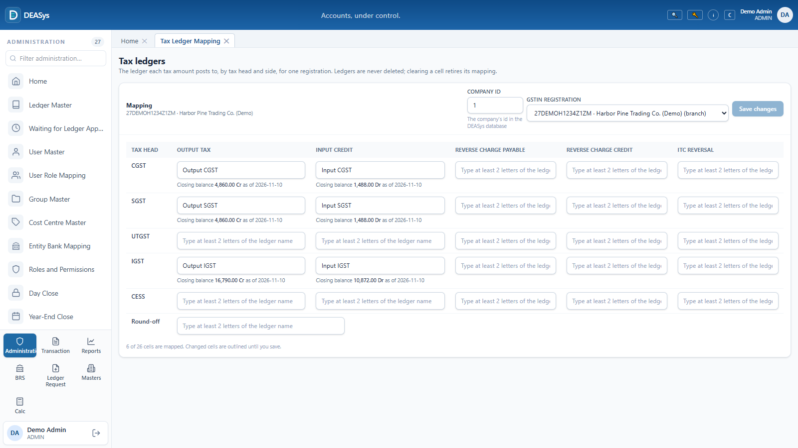
*Tax Ledger Mapping.*

**Step 5. HSN and SAC rates: HSN and SAC Rates** (menu **GST > HSN and SAC Rates**, the same screen as **Ledger Request > GST Master**, `/masters/gst`).

Each rate has an HSN or SAC code, the CGST, SGST, IGST and cess rates, and an effective period. Press **+ Add** for a new rate.

| Field | Meaning | Rules |
|---|---|---|
| HSN / SAC code | The goods or service code. | Required; at most 20 characters. |
| CGST, SGST, IGST, cess | The rates in per cent. | From 0 to 100. |
| Effective from | The first day the rate applies. | Required. |
| Effective to | The last day the rate applies. | Cannot be before Effective from. |

An obsolete rate cannot be changed or deleted. Filter with **Include obsolete** to see the old rates.


*HSN and SAC Rates.*

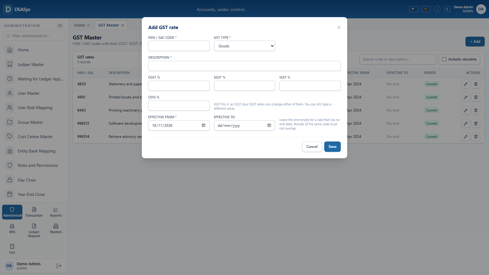
*Adding a GST rate.*

**Step 6. Check a GSTIN: GSTIN Check** (`/gst/gstin`, see section 8.1).

**Using GST on an invoice.** On a sales invoice, each line takes an HSN or SAC code and a tax rate, and a **Tax ledger**. The **GST preview** box shows the taxable amount and the CGST, SGST, IGST and total as you type. The tax is split by the place of supply: the invoice takes the registration and the state from the customer's GST details.

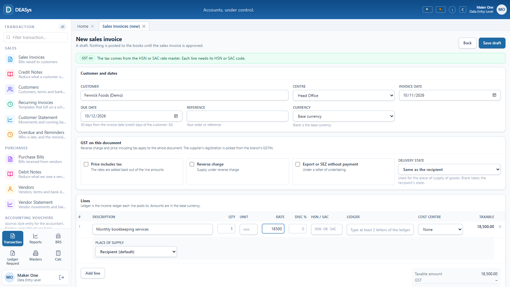
*The tax ledger on an invoice line.*

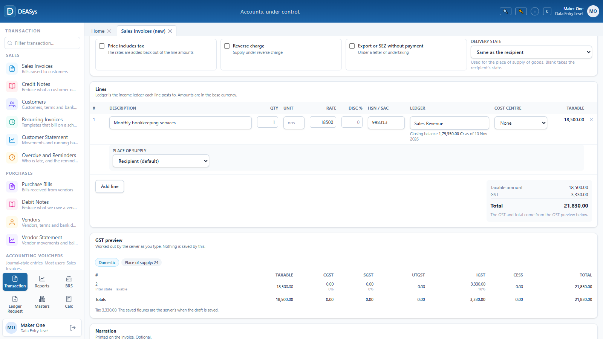
*The GST preview on a sales invoice.*

Once the invoice is posted, the invoice view shows the **GST breakup** and the **E-invoice (IRN)** block (section 8.1).

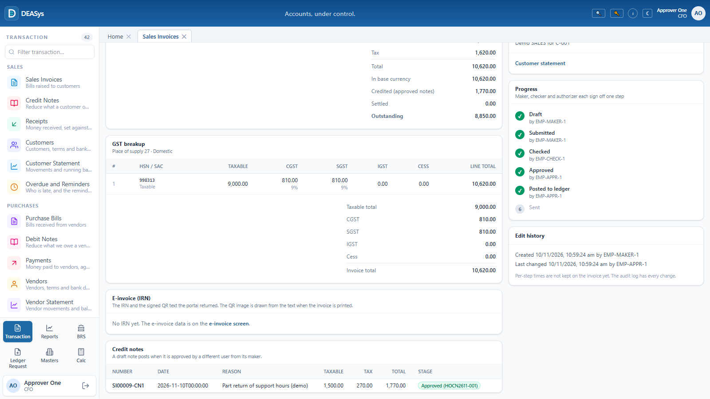
*The IRN block on a posted invoice.*

### 6.14 TDS and TCS setup

The TDS and TCS screens are in **Administration > Tax (TDS and TCS)** for the masters, and in **Transaction** for the operations (section 8.2).

Set up in this order:

1. **TDS Rates** (`/tds/rates`, menu **Administration > TDS Rates**). A rate applies from its effective date. Two rates for the same section and deductee type cannot overlap in time. Sections are provisions of the Act (for example 194C). Sections are retired, not deleted.

   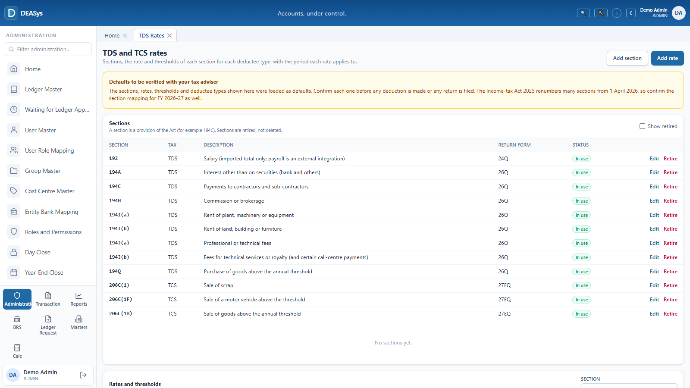
   *TDS Rates.*

2. **TDS Parameters** (`/tds/parameters`). The effective-dated values the calculator uses: surcharge, cess, the rate for a missing PAN, and the interest percentages.

   
   *TDS Parameters.*

3. **TDS Deductor** (`/tds/deductor`). Who deducts the tax (the TAN and PAN of the company or branch) and the **payable ledger** each tax is credited to. There is one live deductor per company and branch. The payable ledger must not be bill-wise.

   
   *TDS Deductor.*

4. **Deductee Profiles** (`/tds/deductees`). For each party that is deducted: PAN, deductee type, the default section and any lower-deduction certificate.

   
   *Deductee Profiles.*

Then, on a payment voucher, the **TDS panel** calculates the deduction (section 7.1).


*The TDS panel on a payment voucher.*

> **Verify before use.** The section numbers, rates, thresholds and the no-PAN rate are **defaults** that a tax adviser must verify before any deduction is filed. The Income-tax Act 2025 takes effect on 1 April 2026 and renumbers these provisions; confirm the section mapping and the forms for the financial year.

### 6.15 Cheque books

Menu: **BRS > Cheque books** (`/cheques/books`). A cheque book holds one leaf per number (unused, used, cancelled or stopped). Create the book for each bank account, then issue cheque numbers on payments with **Cheque assign and print** (`/cheques/assign`). Cheques dated after the payment day are listed under **Post-dated cheques** (`/cheques/post-dated`) until they clear or bounce.


*Cheque books.*


*Cheque assign and print.*


*Post-dated cheques.*

Issuing a cheque number that is used, cancelled or stopped is refused. The print view gives the payee, the amount, the amount in words (Indian lakhs and crores) and the date. Print is refused for a leaf that has not been issued.

### 6.16 Integrations

Set up API keys, the inbox and webhooks when another system is ready to connect. See [section 11](#11-integrations).

---

## 7. Daily work

### 7.1 Vouchers: the basics

A voucher records one business event. The **Transaction** section has the voucher forms.

| Form | Menu | Use it for | Address |
|---|---|---|---|
| Receipt | Transaction > Receipt | Money received from a party into a cash or bank ledger | `/vouchers/new/receipt` |
| Payment | Transaction > Payment | Money paid to a party from a cash or bank ledger | `/vouchers/new/payment` |
| Contra | Transaction > Contra | Moving money between cash and bank, or between two bank ledgers | `/vouchers/new/contra` |
| Journal | Transaction > Journal | Adjustments and provisions, in lines | `/vouchers/new/journal` |
| Capex | Transaction > Capex | Capital purchases | `/vouchers/new/capex` |
| Audit | Transaction > Audit | Audit adjustments | `/vouchers/new/audit` |
| MEE | Transaction > MEE | Marketing and events | `/vouchers/new/mee` |

The **New voucher** group shows these with a short hint each. Receipt, payment and contra have their own forms; the others use the line grid.

**Receipt** (`/vouchers/new/receipt`).


*A new receipt.*


*A receipt, filled in.*

| Field | Meaning | Example | Rules |
|---|---|---|---|
| Date | The date of the voucher. | 2026-11-09 | Required. The day must be open. |
| Circle, Centre | The branch the voucher belongs to. | Head Office | Choose from the list. |
| Received from | The party ledger the money comes from. | Fennick Foods (Demo) | Required. |
| Received into | The cash or bank ledger that receives the money. | Demo bank ledger | Required. Cash or bank only. |
| Amount | The amount received. | 1,180.00 | Greater than zero, at most two decimals. |
| Mode | Cash, Cheque, UPI, Bank transfer or Card. | Bank transfer | Required. |
| Cheque number, Cheque date | Shown for a cheque. | 004512 | Both required for a cheque. |
| Reference, Date of transfer | Shown for a transfer or a card payment. | Transfer reference | Required for a transfer. |
| Narration | What the voucher is for, printed on it. | Part payment of invoice SI1000/00012 | Required. |

**Save Draft** keeps an unfinished voucher. **Submit for Approval** sends it to the checker (section 7.4).

**Payment** (`/vouchers/new/payment`). The same form the other way round: **Paid to** (the party), **Paid from** (the cash or bank ledger), **Amount**, **Mode**, and for a cheque the **Favouring (payee name)**. The TDS panel calculates the deduction when a deductor exists (section 6.14).


*A payment voucher.*

**Contra** (`/vouchers/new/contra`). **From account** and **To account** must be different cash or bank ledgers. A cheque or online transfer needs a bank ledger as one of the two accounts.


*A contra voucher.*

**Journal** (`/vouchers/new/journal`). One line per ledger, with an amount in the debit or the credit column. The screen shows **Balanced** or **Not balanced** as you type. The voucher cannot be submitted until it balances.


*A journal voucher.*


*The cost split dialog.*


*A journal that does not balance is refused.*

**All Vouchers** (menu **Transaction > All Vouchers**, `/vouchers`) lists every voucher with its status and type, and you can filter by status and type.


*All Vouchers.*

> **Behind the scenes.** A saved voucher is a draft. Nothing reaches the ledgers until the authorizer posts it. Posting creates the voucher number from the numbering series, writes the lines to the ledgers and records each step in the status history. A posted voucher is corrected by a reversal, not by editing it.

### 7.2 Bulk transactions

Menu: **Transaction > Bulk Transaction** (`/bulk`). Move several vouchers one step at a time in one action. All selected vouchers must move: a refused voucher stops the whole batch and is named by its number.


*Bulk Transaction.*

### 7.3 Sales invoices

Menu: **Transaction > Sales Invoices** (`/sales/invoices`). The register lists every sales invoice with its number, customer, dates, amount and status. Use the filters to narrow the list.

Statuses, as the screens show them: **Draft**, **Waiting for checker**, **Waiting for authorizer**, **Approved**, **Posted**, **Sent**, **Part paid**, **Paid**, **Overdue** and **Cancelled**. Part paid, paid and overdue are read from the money on the invoice and its due date.


*Sales Invoices.*

**Create an invoice.** Press **New**, or open `/sales/invoices/new`.


*A new sales invoice.*

**Header fields**

| Field | Meaning | Rules |
|---|---|---|
| Customer | The party to bill. | Type at least two letters and choose from the list. |
| Invoice date | The date of the invoice. | Required. |
| Due date | When payment is due. | Used for overdue reports. |
| Reference | Your reference, for example a purchase order number. | Optional. |
| Currency and Exchange rate | The currency and its rate to the base. | Enter the rate for a foreign currency. |
| Narration | Printed on the invoice. | Optional. |

Billing and shipping address, state, pincode, place of supply, payment terms, customer notes (printed) and internal remarks (never printed) are copied from the customer and can be changed on the invoice.

**Line fields**

| Field | Meaning | Rules |
|---|---|---|
| Description | What is being sold or bought. | Required; at most 250 characters. |
| Qty and Unit | Quantity (up to 3 decimals) and unit, for example nos. | |
| Rate | Price per unit (up to 4 decimals). | |
| Tax | The tax rate for the line. | Set from the HSN or SAC rate. |
| Tax ledger | The ledger the tax is booked to. | Required when a line has tax. |
| Ledger | The sales or purchase ledger for the line. | |
| Cost centre | Optional cost centre for the line. | |
| Amount | Qty times Rate, less discount, rounded to 2 places. | Read only. |

Use **Add line** to add a line and the remove control to delete one. The **Totals** box shows the taxable amount, the tax and the total. With GST on, the GST preview shows CGST, SGST, IGST and UTGST as the place of supply requires (section 6.13).


*A sales invoice, filled in, with its totals.*


*The GST preview.*

**Workflow of an invoice.** Each step is an action button on the invoice screen.

| Step | Status | Action | Who |
|---|---|---|---|
| Draft | Draft | **Save draft** | Maker |
| Submitted | Waiting for checker | **Submit** | Maker |
| Checked | Waiting for authorizer | **Check** | Checker (not the maker) |
| Approved | Approved | **Approve** | Approver (not the maker or checker) |
| Posted | Posted | **Approve and post**, or **Post to ledger** when the step is separate | Approver with the posting permission |
| Sent | Sent | **Mark as sent** | Anyone with the send permission |


*A submitted invoice.*


*The Post to ledger button on an approved invoice.*


*A posted invoice, with its voucher number.*

**Rejecting an invoice.** A checker or approver can reject a submitted or checked invoice. The reason is required. The invoice goes back to Draft; the maker edits and resubmits.

*Screenshot not included in this release: the invoice view has no Reject button in this release (the server supports rejecting an invoice, the screen does not offer it): a product gap.*
*The reject dialog.*

**Cancel invoice.** An unposted invoice can be cancelled without a ledger entry. Cancelling a posted invoice posts a reversing voucher (see [open issues](docs/guide-open-issues.md)).

**Mark as sent** records that the invoice was sent. DEASys does not e-mail it: send the PDF or the print view from your own mail.

**Print view and PDF.** **Print view** shows the invoice as it is printed: company block, bill-to, lines, totals, amount in words, and the GST breakup and IRN when they exist.


*The printed invoice.*

**Attachments.** Upload a PDF, PNG, JPEG, xlsx, docx or csv file. At most 5 MB per file and 10 files per invoice. Uploading and deleting are allowed while the invoice is a draft; afterwards you need the attach permission. DEASys does not scan attachments for viruses.

*Screenshot not included in this release: no attachments screen for invoices in this release (attachments are not uploaded yet, per the ledger request screen).*
*Attachments.*

**E-invoice (IRN) on the invoice.** After posting, the invoice view shows the IRN and the signed QR text the portal returned, once a connector has recorded them (section 8.1). DEASys does not draw the QR image.

**Customer Statement** (`/sales/statement`, menu **Transaction > Customer Statement**). Invoices, notes and receipts for one customer, with a running balance. Click a row to drill down to its voucher lines.


*Customer Statement.*

*Screenshot not included in this release: the customer statement opens for a customer chosen in its filter; the drill-down row is not driven by this script yet.*
*Drill-down from a statement row to its voucher lines.*

**Recurring Invoices** (`/sales/recurring`). A template makes a **draft** invoice on each run date, monthly, quarterly or yearly. Nothing is approved or posted by a run.


*Recurring Invoices.*


*A new recurring template.*

**Overdue and Reminders** (`/sales/overdue`). Customers past their due date. Pick one to see its reminder letter. Nothing is sent; you copy the letter.


*Overdue and Reminders.*

### 7.4 Approvals and My Task

Approvals follow the maker, checker, authorizer pattern.

**Vouchers.** When a maker submits a voucher, it goes to the checker's **My Task** (`/tasks`). The checker checks it and sends it on; the authorizer authorizes it, which posts it to the ledgers. The status history shows each step.

- **Approve** moves the voucher one step forward.
- **Reject** sends it one step back, with a **reason** (at most 500 characters). A voucher waiting for a checker goes back to Draft; a voucher a checker has checked goes back to waiting for the checker. A person who made or checked a voucher cannot reject it at a step they took.


*My Task.*


*Approving a voucher in My Task.*

**Invoices.** Invoices use the same idea with their own steps (section 7.3): Submit, Check, Approve, and posting. Rejecting needs a reason.

**My Requests** (menu **Transaction > My Requests**, `/requests`) shows vouchers you sent that are still moving.


*My Requests.*

**Ledger requests.** **Ledger Request > My Ledger Requests** (`/my-ledger-requests`) shows your ledger requests. The administrator's queue is **Administration > Waiting for Ledger Approval** (section 6.3).


*My Ledger Requests.*

> **Behind the scenes (posting).** When an authorizer posts a voucher, DEASys checks the balance, the open period (the day must not be closed), the bill reference of bill-wise lines and the credit and budget controls. It creates the voucher number from the series, writes the ledger lines, and records the authorizer, the time and the status history in one transaction. If a check fails, nothing is written and the reason is shown.

### 7.5 Bank reconciliation and bank files

Use these screens in this order each month. They are in the **BRS** section.

1. **Bank Upload** (`/bank-upload`): choose the bank statement file (.xlsx or .xls, at most 10 MB) and the bank ledger.
2. **Bank Process** (`/bank-process`): match the uploaded lines with the ledger entries.
3. **Bank Reconciliation (BRS)** (`/brs`): the bank reconciliation statement. Entries not yet reflected in the bank are shown. Print or export it.
4. **Bank File** (`/bank-file`): the NEFT payments (cheques dated in the range you choose) for the bank's upload file, with the upload report.


*Bank Upload.*


*Bank Process.*


*Bank Reconciliation (BRS).*


*Bank File: NEFT payments.*

### 7.6 Purchase bills, debit notes and payments

These mirror the sales side under **Transaction**.

- **Purchase Bills** (`/purchases/bills`): bills received from vendors, entered like sales invoices.
- **Debit Notes** (`/purchases/debit-notes`): reduce what we owe a vendor against an approved bill. A debit note is a draft until a different user approves it.
- **Payments** (`/purchases/payments`): money paid to a vendor, set against its bills. Any excess is an advance.
- **Vendor Statement** (`/purchases/statement`): bills, payments and balance for one vendor.


*Purchase Bills.*


*A new purchase bill.*


*Debit Notes.*


*Payments to vendors.*


*Vendor Statement.*

### 7.7 Receipts against invoices

**Receipts** (`/sales/receipts`) records money received from a customer and sets it against its invoices. The screen lists the outstanding invoices with an amount to allocate to each. **Allocate oldest first** fills the oldest invoices first. Left blank, the rest stays unallocated: an excess becomes an advance on account.

Each allocated invoice is locked and checked again when the receipt posts.


*Receipts against invoices.*

> **Note.** Receipts and credit and debit notes still post a draft voucher at approval, so they go through the voucher workflow a second time (see [open issues](docs/guide-open-issues.md)).

### 7.8 Credit notes

**Credit Notes** (`/sales/credit-notes`). A credit note reduces what a customer owes against one approved, posted invoice. It can cover only what each line still allows. A credit note is a draft until a different user approves it.


*Credit Notes.*


*A new credit note.*

### 7.9 Calc

**Calc** (`/calc`) is a quick calculator for amounts. It posts nothing.


*Calc.*

---

## 8. Periodic work: GST, TDS and TCS, closes

### 8.1 GST

The GST screens are in the **Transaction > GST** group. They cover the setup (section 6.13), the periodic work below and the e-invoice and e-way bill data.

**What DEASys does and does not do**

- It computes the tax on invoices, keeps the registrations, the state codes and the tax ledgers, and prepares the return **data** (the tables) from the books.
- It checks the data (the tie-out), freezes a snapshot of a return for filing, and records when a return is filed.
- It reconciles the purchase credit with the GSTR-2A and 2B files you import.
- It builds the **e-invoice** (INV-01) and **e-way bill** payloads and records the results a **connector** reports back.
- It does **not** file returns with the GST portal, does not generate the IRN or the e-way bill itself, and does not draw the QR image. The connection to the portal is external.

**GST Returns** (`/gst/returns`, menu **GST > GST Returns**).

1. Pick the **registration**, the **return** (for example GSTR-1 or GSTR-3B), and the **period** (financial year and month).
2. The tables come from the books. Each check is shown green when it agrees and red when it does not. Use the check to see the figures behind each row.
3. **Freeze** fixes the tables in a snapshot for filing. A blocking check stops the freeze unless it is forced with a reason (**Freeze anyway (forced)**). Each freeze stores a version; older versions are listed without their figures.
4. After you file the return at the portal, press **Mark as filed** and give the filed-on date. A late payment of tax is recorded with the paid-on date.
5. **Unfreeze** reopens a frozen return if it must change. Freeze again after the change.


*GST returns: the tie-out checks for a return and period.*

*Screenshot not included in this release: the Mark as filed dialog opens from a GST return that has been prepared; the demo has no prepared return.*
*Marking a return as filed.*

**GST Filing Calendar** (`/gst/calendar`, menu **GST > Filing Calendar**). The due date of each return and period, with the status of each: not started, data ready, frozen or filed. Overdue items are shown.


*GST filing calendar.*

**Late Fee and Interest** (`/gst/calculators`, menu **GST > Late Fee and Interest**). Calculate the late fee on a return (the filed-on date against the due date) and the interest on late tax or reversal. The rates and the fee rules are defaults in the GST parameters: check them with your tax adviser.


*Late fee and interest.*

**ITC ledgers and reversals.**

- **ITC Ledgers** (`/gst/itc`): the electronic credit ledger, the cash ledger and the liability ledger of a registration, with every entry that moved them.
- **ITC Reversals** (`/gst/itc/reversals`): credit given back under rules 42 and 43, blocked credit under section 17(5), and non-payment within 180 days. Each one reduces the electronic credit ledger. Press **Record ITC reversal**.
- **Payment Challans** (`/gst/itc/challans`): pay the month's liability from the credit ledgers first (IGST, then CGST, SGST and cess), and deposit the rest in cash. **Record GST payment challan** takes the tax head, the amount, the challan date and the number (optional). The **Set-off preview** shows how the credit is used before you record.
- **Non-payment (180 days)** (`/gst/itc/non-payment`): purchase bills that claimed input credit and are still unpaid after the non-payment period. The credit has to be reversed.


*ITC ledgers.*


*ITC reversals.*


*GST payment challans.*


*Non-payment exceptions.*

**GSTIN Check** (`/gst/gstin`, menu **GST > GSTIN Check**). Checks the shape, the check character and the state of a GSTIN. A live lookup at the portal is not part of this server.


*GSTIN check.*

**GSTR-2A and 2B Reconciliation** (`/gst/recon`, menu **GST > GSTR-2A/2B Reconciliation**).

1. **Import the portal file.** Choose the **Period** and the **Source** (2A or 2B), choose the GSTR file as the portal gives it (JSON, unchanged), then press **Upload and import**. The same file imported twice is not added again.
2. **Run matching.** Each portal row is paired with a purchase bill by supplier GSTIN, document number, date and value (within the tolerance). Pairs already matched are left alone.
3. **Results.** Matched pairs carry the input credit. Check the rows that are left: **Match to a purchase bill** pairs a portal row by hand; **Unmatch** removes a match with a reason.
4. **Exceptions** lists credit claimed in the books that the portal does not show, and portal rows with no bill.
5. **ITC summary** shows the totals.


*Import the portal file.*

*Screenshot not included in this release: needs a GSTR-2A/2B portal file imported first; the demo holds no portal file.*
*Reconciliation results, with the match and unmatch actions.*

**E-invoice and e-way bill** (`/gst/einvoice`, menu **GST > E-invoice and E-way Bill**). This is data for a connector, not a portal connection.

1. **E-invoice pending** lists the sales invoices that need an IRN, with the problems that stop them. Only ready invoices are sent by the connector.
2. Open an invoice (`/gst/einvoice/:invoiceId`). The **Payload** is the INV-01 payload this server builds. The connector submits it unchanged. The **IRN result** is what the connector got back: record it with the acknowledgement number and date, the IRN and the signed QR text (signed invoice optional). Press **Record result**.
3. To cancel an IRN, record the cancellation the connector made, with the reason and remarks. It is allowed within the window in the e-invoice parameters.
4. **E-way bill**: build the e-way bill payload, with the transport mode (road, rail, ship or air), the distance, the transporter id and the vehicle number. The bill threshold decides whether one is needed. Record the e-way bill number and its valid-up-to date with **Record e-way bill result**.


*E-invoice pending.*


*E-invoice payload and IRN result.*


*E-way bill.*

**Files.** Payloads can be downloaded as JSON text. The connector, not DEASys, sends them to the portal.

### 8.2 TDS and TCS

TDS is deducted on payments (section 7.1) and recorded as **deductions**. Deposits are recorded as **challans**. The operations screens are in **Transaction**.

- **TDS Deductions** (`/tds/deductions`, menu **Transaction > TDS Deductions**). Every deduction recorded from a voucher or a salary total, with its tax and whether it has been deposited. Filter by financial year, quarter, section and deductee.

  
  *TDS deductions.*

- **Challans** (`/tds/challans`, menu **Transaction > Challans**). Deposits of tax to the government, with the deductions each one pays for. Allocate a deposit to deductions; a deposit cannot exceed the deduction, the challan's tax, or come before the deduction date.

  
  *TDS challans.*

- **TDS Return Data** (`/tds/returns`, menu **Transaction > TDS Return Data**). The data for Forms 26Q, 27Q and 27EQ, for review: the deductees and challans behind a return. Choose the form, the financial year and the quarter.

  
  *TDS return data.*

- **Certificates (16A, 27D)** (`/tds/certificates`, menu **Transaction > Certificates (16A, 27D)**). The view and print of the certificate for one deductee: Form 16A for TDS and 27D for TCS. The statutory print layout is not in this release.

  
  *Certificates.*

- **TDS by Section** (`/tds/summary`, menu **Transaction > TDS by Section**). The tax payable per section in the period, how much is deposited and what is still pending.

  
  *TDS by Section.*

- **TDS Exceptions** (`/tds/exceptions`, menu **Transaction > TDS Exceptions**). Deductions not deposited by their due date, or deposited short. Select a row to see the interest a late deposit would attract. Check these before a return is prepared.

  
  *TDS exceptions.*

> **Not a filing file.** The return data is for review and for your file-preparation tool. DEASys does not generate the NSDL/FVU text file, Form 24Q (salary) or the statutory certificate print in this release. Deposit due dates fall on the 7th of the next month (30 April for a March deduction).

For integrators: the same data is available through the API (`GET /api/v1/tds/challans` and `GET /api/v1/tds/returns/26Q?format=csv`).

*Screenshot not included in this release: terminal capture: needs a real PowerShell or Command Prompt window; this script does not drive a terminal, and the output is not faked.*
*TDS challans through the API.*

*Screenshot not included in this release: terminal capture: needs a real PowerShell or Command Prompt window; this script does not drive a terminal, and the output is not faked.*
*TDS return data through the API.*

### 8.3 Forex, interest and budgets

- **Forex revaluation** (`/forex/revaluation`, menu **Forex revaluation**, in the Transaction section). Choose the currency and the as-of date. The screen previews the gain or loss on the foreign balances. **Save as draft** saves a journal as a draft; a different user must authorize it. Bill-wise ledgers are skipped.

  
  *Forex revaluation.*

- **Interest settings** (`/interest/settings`) set the rate per year, the day basis (365 or 360), simple or compound interest, grace days and whether interest runs from the voucher or the due date, per ledger or per group. A ledger's own setting wins.
- **Interest statement** (`/interest/statement`) computes the interest for a period and can post it as a draft journal. Opening balances are not charged.

  
  *Interest settings.*

  
  *Interest statement.*

- **Budget variance** is in the reports (section 9).

### 8.4 Day close and year-end close

**Day Close** (`/period/day`, menu **Administration > Day Close**). A day close stops new vouchers for a centre on a date. Choose the date and the centre, check the day first, then close it. The screen lists the closed days of the last 31 days.


*Day Close.*

To reopen a closed day, use **Reopen** on its row and give the reason.


*Reopening a closed day.*

Posting to a closed day is refused:

*Screenshot not included in this release: the closed-day message is not reached on the payment form: it first asks for cheque or online details (a product problem, also for a cash ledger); not captured.*
*A posting to a closed day is refused.*

**Year-End Close** (`/period/year`, menu **Administration > Year-End Close**). Close a financial year once it has ended and every voucher in it is authorized. The **Close year** button is disabled while vouchers are pending. Reopen a closed year from its row if you must. The screen also carries the **carry-forward** of balances to the next year: preview the balances, then carry them forward. Do this once per year, after the year's last day is closed.


*Closing a financial year.*

### 8.5 Month-end checklist

1. **Bank.** Upload the statement, process it, and check the BRS (section 7.5).
2. **Invoices and bills.** Every invoice and bill for the month is posted, not waiting in My Task. Check **Sales Invoices** and **Purchase Bills** for Draft and Waiting items.
3. **Receipts and payments.** Allocate receipts and vendor payments to their invoices and bills.
4. **Overdue.** Review **Overdue and Reminders** and send reminders yourself.
5. **GST.** Check the tie-out of the month's returns; reconcile 2A and 2B; record the payment challans; freeze the returns (section 8.1).
6. **TDS.** Review **TDS Exceptions**, record the challans, and check **TDS by Section** (section 8.2).
7. **Forex and interest.** Revalue foreign balances and review interest (section 8.3).
8. **Budgets.** Review the budget variance report (section 9).
9. **Day close.** Close each finished day of the month (section 8.4).
10. **Reports.** Run the trial balance, profit and loss and balance sheet, and keep the copies (section 9).
11. **Backup.** Take a backup (section 10.3).

---

## 9. Reports

### 9.1 The Reports menu

Menu: **Reports** (`/reports`) lists the report families grouped by subject. Pick a family, then a view of it, set the dates and the centre, and run it. **Saved Reports** (`/reports/saved`) is at the end of the Reports section.


*The Reports menu.*

The main reports:

| Report | Shows |
|---|---|
| Trial Balance | Every ledger's debit and credit totals for a period |
| Profit and Loss | Income and expense groups, and the net result |
| Balance Sheet | Liabilities and assets, with equal totals |
| Debtors Ageing, CR Payable Ageing | What customers and vendors owe, by age |
| Customer Statement, Vendor Statement | Invoices, notes, receipts and the running balance for one party |
| Invoice Register, Overdue Invoices | Invoices for a period; invoices past due |
| Cost Centre Summary, Cost Centre Ledger Breakup | Cost by cost centre |
| Budget Variance | Budget against the actual, to date |
| Cash flow (direct and indirect), funds flow, ratio analysis | Financial statements |
| Exception reports | Unusual or incomplete entries |
| TDS and GST reports | The TDS and GST data views (sections 8.1 and 8.2) |
| Forex Gain and Loss Summary, Interest Statement | Forex and interest |


*Trial Balance.*


*Profit and Loss.*


*Balance Sheet.*


*Debtors Ageing.*


*Cost Centre Summary.*

*Screenshot not included in this release: the Budget button of Cost Centres and Budgets opens the Budgets master, not the Budget Variance view (a product gap in the report menu).*
*Budget Variance.*

### 9.2 Running a report

1. Open **Reports**, then the family.
2. Choose the **view** from the list, or leave the default.
3. Set the **From** and **To** dates, and the centre (**All centres** or one).
4. The report runs. Totals are at the foot.

Financial reports also accept a split (by month, quarter, financial year or circle) and a comparison with the previous period.

### 9.3 Drill-down

Click a figure in a report to see the vouchers behind it. The **Vouchers Behind a Figure** screen (`/reports/drill`) lists the voucher lines for that ledger, group or cell. Statements also drill down from a row.

*Screenshot not included in this release: the drill-down needs a ledger row in a run report; the Trial Balance returns no ledger rows in this build (see the product problems).*
*Drill-down from a report figure.*

### 9.4 Export and print

Every report has an **Export format** choice:

- **CSV** (UTF-8 with a byte-order mark, so Excel opens it correctly), with **Export CSV**.
- **Excel (.xlsx)**, with **Export Excel**.
- **Print view (HTML)** and **Print view (PDF)**, with **Print**.

*Screenshot not included in this release: the export format choice sits in the save-view dialog; not driven by this script yet.*
*The export formats.*


*Exporting and printing a report.*

### 9.5 Saved reports

**Saved Reports** (`/reports/saved`, menu **Reports > Saved Reports**) keeps report views with their filters. Open one to run it again with the same settings. Saved views are not e-mailed.


*Saved Reports.*

*Screenshot not included in this release: terminal capture: needs a real PowerShell or Command Prompt window; this script does not drive a terminal, and the output is not faked.*
*Saved report definitions through the API.*

> **Reports that do not run.** A few catalogue rows are served by SQL Server Reporting Services and a few stored-procedure reports are not yet ported. The screen says "Not available yet" for them. Do not rely on them until the release notes say they are available.

---

## 10. Administration

### 10.1 Users and roles

Maintain people in **User Master** (section 6.5), give each one a role in **User Role Mapping** (section 6.7), and set what roles may do in **Roles and Permissions** (section 6.6). Deactivate a user who leaves rather than deleting the user; the audit log keeps the history.

### 10.2 Passwords

- **Change your own password:** the key button in the top bar (section 5.5).
- **Reset another user's password:** the administrator sets a new password for the user, who must change it at the next sign-in.
- **From the command line:** `deasys-server.exe set-password <login>` (prompted, nothing echoed).


*Resetting a user's password.*

**Sign-in is paused after repeated failures.** Five failed attempts for one user or address within 15 minutes give a 429 response. Wait for the time shown, then try again.


*Sign-in paused after repeated failures.*

### 10.3 Backup and restore

Backups are taken from the command line. A backup is a PostgreSQL dump of the database. It holds every password hash and the audit trail, so keep it secret. The installer's backups folder is `C:\ProgramData\DEASys\backups`. Run from an elevated PowerShell:

```powershell
& "C:\Program Files\DEASys\deasys-server.exe" backup "C:\ProgramData\DEASys\backups\manual-$(Get-Date -f yyyyMMdd-HHmm).dump"
```

- A backup file is never overwritten. Choose a new name each time.
- The backup can be taken while DEASys runs.
- Copy each backup off this computer as well, and restrict access.
- Back up `deasys.conf` separately. It holds the key and the connection. Without the key, sign-in tokens do not carry over to a restored system.

*Screenshot not included in this release: terminal capture: needs a real PowerShell or Command Prompt window; this script does not drive a terminal, and the output is not faked.*
*Taking a backup.*

**Restore** into an empty database:

```powershell
& "C:\Program Files\DEASys\deasys-server.exe" restore "C:\ProgramData\DEASys\backups\manual-20261109-1200.dump"
```

Restore is refused when the database already holds DEASys tables. Use `--force` only when you mean to replace the database. After restoring a dump from an older version, run `migrate`.

*Screenshot not included in this release: terminal capture: needs a real PowerShell or Command Prompt window; this script does not drive a terminal, and the output is not faked.*
*Restoring a backup.*

> **Backups and restore are commands in this release.** There is no screen for them yet. Test a restore into a spare database at least once a quarter.

### 10.4 Logs

The log is `deasys.log` in the logs folder. It is rotated at 20 MB or at the first write of a new day, and the newest 14 rotated files are kept. Passwords, keys and tokens are never logged; sign-in names and client addresses are. The installer log is `install.log`, and the database log is `postgres.log`.

*Screenshot not included in this release: terminal capture: needs a real PowerShell or Command Prompt window; this script does not drive a terminal, and the output is not faked.*
*The log folder.*

### 10.5 Upgrades and migrations

Follow section 4.5 (installer or zip). The database changes apply when the new server starts, and a failing migration is rolled back. The server refuses to run against a database that is newer than it. The web interface can be updated on its own: place a newer copy in the `ui\` folder beside the program (or set `ui_dir`).

### 10.6 Running behind HTTPS

The server does not terminate TLS. For use from other computers, put a TLS reverse proxy in front of it (IIS with Application Request Routing, nginx or Caddy) and point it at the loopback address. Then set `public_url` to the address users see. Do not open the port to the network without TLS.

### 10.7 Audit log

**Audit log** (menu **Administration > Audit log**, `/audit`) shows changes to masters, vouchers, users, roles, cheques and numbering series, newest first. Each entry has who, when, the entity, the action, and the values before and after. Filter by entity, by person or by date.

The audit log is read only. No screen or route edits or removes an entry.


*Audit log.*

Not in the audit log in this release: entity-bank mapping changes, GST rate changes, ledger request approvals and rejections, and drafts (a draft is not a voucher). See [open issues](docs/guide-open-issues.md).

### 10.8 About

**About** (the (i) button in the top bar, `/about`) shows the version and the licence.


*About DEASys.*

---

## 11. Integrations

Other systems connect through the API. The administration screens manage the keys, the inbox and the webhooks, in the **Administration** section.


*How to Connect (menu **Administration > How to Connect**).*

### 11.1 API keys (Administration > Integration Keys)

Open **Administration > Integration Keys** (`/admin/integrations/keys`). The list shows each key's prefix, source system, scopes, branches, status and last use.

**Create an integration key.** Press **Create a key** and fill in:

| Field | Meaning | Rules |
|---|---|---|
| Name | What the key is for, for example ERP feed. | Required. |
| Source system | The system that uses the key, for example ERP. It is stamped on every document the key creates. | Required. |
| Scopes | `invoices.import`, `vouchers.import`, `tds.import`, `masters.read`, `reports.read`. | At least one. A key reaches only the routes its scopes grant. |
| Branches | The branches the key may post to. | At least one. |
| Posting mode | `draft_for_approval` (default) or `post_directly`. See section 11.4. | |
| Rate limit | Requests a minute. | Default 60, at most 6000. |
| Expiry | Optional end date. | |

Press **Save**. **The key is shown once.** Copy it into your secret store now. The key looks like `acx_` followed by 8 hex characters, an underscore and 43 characters. DEASys keeps only a hash of it.


*Creating an integration key: the key is shown once.*

**Rotate** replaces the secret at once; the old text stops working. **Revoke** needs a reason and cannot be undone.


*Integration Keys.*

Send the key only on `/api/v1/integration/*`, in the `X-Api-Key` header. Any other route ignores it.

```bash
curl -s "http://localhost:8080/api/v1/integration/branches?limit=5" -H "X-Api-Key: $DEASYS_API_KEY"
```

| Status | Meaning | What to do |
|---|---|---|
| 401 | The key is unknown, wrong, expired or revoked. Ten wrong keys a minute lock that prefix. | Stop and ask the administrator. Do not retry in a loop. |
| 403 | The key lacks the scope for this route. | Ask for the scope. |
| 422 | A business rule refused the data. The answer lists the reasons. | Fix the data and send again. |
| 429 | Over the rate limit. | Wait the `Retry-After` seconds. |

### 11.2 Idempotency

Every invoice, voucher and TDS total carries an `idempotencyKey` that you choose, for example your document number `ERP-SI-2026-000123` (at most 120 characters). Sending the same key with the same content again does not create a second document: the answer is `"status":"existing"` with the original ids. Reusing a key for different content is refused. After a timeout or a 5xx answer, send the same request again.

A batch is all or nothing: if one item is refused, nothing in the batch is imported, and the answer lists the reasons per item.

### 11.3 Imports

**Invoices** (`POST /api/v1/integration/invoices/import`):

```bash
curl -s -X POST http://localhost:8080/api/v1/integration/invoices/import \
  -H "X-Api-Key: $DEASYS_API_KEY" -H "Content-Type: application/json" -d '{
  "invoices": [{
    "idempotencyKey": "ERP-SI-2026-000123",
    "invoiceKind": "SALES",
    "partyId": 41,
    "centreId": 1000,
    "invoiceDate": "2026-11-09",
    "reference": "PO-7781",
    "lines": [{"description": "Consulting", "quantity": 2, "rate": 500.00, "taxRate": 18,
               "accountLedgerId": 9001, "taxLedgerId": 9002}]
  }]
}'
```

The answer gives the invoice id and number, and a status: `created` (a draft), `posted` (a post-directly key), `existing` (a repeat) or `rejected`.

**Journals and other vouchers** (`POST /api/v1/integration/vouchers/import`): up to 200 balanced vouchers per request, 200 lines each. The voucher type is given by name or id; each line by ledger id or ledger name (a name must match exactly one ledger). Amounts are positive with at most two decimals, and the debit total must equal the credit total.

**Salary TDS total** (`POST /api/v1/integration/tds/deductions`, section 192 only): one total per payroll run. It answers 201 for a new total and 200 for a repeat.

Get the ids of parties, ledgers and branches from the masters reads (section 11.6).

### 11.4 Posting modes

| Mode | What happens | Risk |
|---|---|---|
| `draft_for_approval` (default) | Invoices and vouchers are saved as drafts, for the usual approval in DEASys. | The approval queue grows. |
| `post_directly` | The document is approved and posted at once, as the key (`API-<prefix>`). The separation of duties does not apply to the key. | No human check: a wrong amount or ledger is in the books at once. |

Use `post_directly` only for data approved at the source. Limit the key to the branches and scopes it needs, set an expiry, and review the inbox each day.

### 11.5 The integration inbox (Administration > Integration Inbox)

**Administration > Integration Inbox** (`/admin/integrations/inbox`) lists every message an integration sent, stored before it was processed. Each has a status:

| Status | Meaning |
|---|---|
| `received` | Stored, not processed yet. |
| `accepted` | Saved as a draft, waiting for approval in DEASys. |
| `posted` | Approved and posted, or the TDS total recorded. |
| `rejected` | Refused. The reasons are shown. |
| `duplicate` | The key was seen before; the stored document is returned. |

Filter by status, source, type and date, and search by the idempotency key. For a **rejected** message, fix the cause (for example the ledger now exists) and **retry** it, or **dismiss** it with a reason; a dismissed message is kept.


*Integration Inbox, with the rejected messages and their reasons.*

### 11.6 Reading masters

With the `masters.read` scope, read ledgers, parties, branches and cost centres, with `updatedSince` for an incremental sync, `status` (`ALL`, `ACTIVE`, `OBSOLETE`), `limit` (at most 200) and `offset`:

```bash
curl -s "http://localhost:8080/api/v1/integration/ledgers?updatedSince=2026-11-01&status=ACTIVE&limit=100&offset=0" -H "X-Api-Key: $DEASYS_API_KEY"
```

Page until `offset + items.length` reaches `total`.

### 11.7 Webhooks (Administration > Webhooks)

DEASys can call your system when something happens. Open **Administration > Webhooks** (`/admin/integrations/webhooks`), press **Add a subscription**, and enter a name, the URL and the events. The events are `invoice.approved`, `invoice.cancelled`, `voucher.authorized`, `receipt.recorded` and `integration.rejected`.

The URL must be http or https, must not carry credentials, and must not resolve to a loopback, private or link-local address.

**The signing secret (`whsec_...`) is shown once** after you create the subscription. Store it in your secret store.


*Creating a webhook subscription.*

Each delivery is a `POST` of JSON with the headers `X-DEASys-Event`, `X-DEASys-Event-Id`, `X-DEASys-Timestamp` (unix seconds) and `X-DEASys-Signature` (`v1=` and the HMAC-SHA256 in hex of `<timestamp>.<raw body>`, keyed by the secret). Verify the signature on the raw body before you parse it, refuse a timestamp more than 5 minutes from now, and ignore an event id you have handled.

Answer 2xx within a few seconds. Any other answer is retried after 30 s, 60 s, 120 s and so on, up to an hour, 8 attempts by default. Open the subscription's **Deliveries** to see each attempt; an administrator can redeliver a failed one. Delivery is at least once, so handle a repeat by event id.


*Deliveries and their attempts.*

**Configuration.** Webhooks are off until the server has `DEASYS_WEBHOOKS=on` and `DEASYS_WEBHOOK_KEY` (at least 16 characters). Without the key, creating a subscription answers 503.

### 11.8 Checklist before go-live

1. One key per source system, with only the scopes and branches it needs, an expiry, and a rate limit above your peak.
2. Idempotency keys from your document numbers, so a resend is safe.
3. The first week in `draft_for_approval`, then decide on `post_directly`.
4. A job that reads the inbox for `rejected` messages and alerts someone.
5. Webhook receivers that verify the signature and the timestamp and ignore repeated event ids.
6. A plan for rotating a key: the new secret is shown once and the old one stops at once.

---

## 12. Troubleshooting and FAQ

### 12.1 Problems and what to do

| What you see | What it means | What to do |
|---|---|---|
| The service will not start; the log says the database is unreachable | The database is not running, or the connection in `deasys.conf` is wrong | Run `deasys-server.exe config show` (passwords masked), check the `DEASysDB` service, and check `postgres.log`. |
| Installer or `install.ps1` fails and rolls back | A step failed; the previous version and database are put back | Read `install.log`. Fix the cause and install again. |
| `migrate` refuses: a script's checksum does not match | An applied migration file was changed | Do not edit applied files. Contact support. |
| `migrate` refuses: the database is newer than the program | An older program is pointed at a newer database | Use the newer program. |
| The first-run wizard answers 409 | The first administrator already exists | Sign in. The wizard is closed for good. |
| The first-run wizard answers 429 | Five attempts from one address in 15 minutes | Wait 15 minutes. |
| Sign-in answers 429 | Five failed attempts for the user or address | Wait for the `Retry-After` time (section 10.2). |
| A voucher says it does not balance | The debit and credit totals differ | Correct the lines until **Balanced** shows (figure above in section 7.1). |
| A voucher is refused on a closed day | The day is closed for the centre | Ask an administrator to reopen the day, or date the voucher on an open day. |
| A voucher is refused: a control is blocked | A credit or budget control in **block** mode | Ask for a budget change, or a warning-only control (section 6.11). |
| "Authorize or delete the pending vouchers first" on Year-End Close | A voucher in the year is still pending | Finish or delete the pending vouchers, then close the year. |
| A GST return will not freeze | A blocking tie-out check fails | Fix the rows in red, or freeze with a reason (**Freeze anyway (forced)**). |
| A reconciliation row stays unmatched | The bill and the portal row differ in GSTIN, number, date or value | Correct the bill, or match by hand with a reason. |
| An integration gets 401 | The key is unknown, wrong, expired or revoked | Ask the administrator. Do not retry in a loop. |
| An integration gets 403 | The key lacks the scope | Ask for the scope. |
| An integration gets 422 with `Voucher <key>: ...` | A rule refused that voucher | Read the reasons, fix the data, and resend with the same key only if the content is the same. |
| A webhook subscription answers 503 | `DEASYS_WEBHOOK_KEY` is not set | Set it on the server and restart. |
| `restore` is refused | The database already has DEASys tables | Restore into an empty database, or use `--force` deliberately. |

### 12.2 FAQ

**Do I need to know accounting to use DEASys?** Daily work is entry and approval. Invoices, receipts and payments look like the paper they replace. Setup (chart of accounts, periods, GST and TDS masters) needs an accountant.

**Why does a voucher have three people?** The maker enters it, the checker checks it and the authorizer posts it. Separating the three makes the books trustworthy.

**Why is my invoice still a draft after I submitted it?** Submitting moves it to the checker. Check My Task on the checker's side, or the invoice's status history.

**Can I edit a posted voucher?** No. Post a reversal, or a credit or debit note. The audit log keeps both.

**Can I delete a voucher?** A draft can be deleted. A posted voucher cannot; reverse it.

**Can I delete a customer?** It becomes obsolete, not deleted. A customer with unpaid invoices or invoices waiting for approval cannot be made obsolete.

**Does DEASys send invoices by e-mail?** No. Use **Mark as sent** to record it, and send the PDF or print view from your own mail.

**Does DEASys file GST or TDS returns?** No. It prepares the return data, the tie-out and the freeze, and records the filing. You file with the portal or your filing tool. DEASys does not generate the TDS NSDL/FVU file or Form 24Q.

**Does DEASys send e-invoices to the portal?** No. It builds the INV-01 and e-way bill payloads, and records the results a connector reports (section 8.1).

**Does DEASys manage inventory or payroll?** No. Connect your inventory or payroll system through the API (section 11).

**Can I run it on Linux?** The Linux build is the server program. Run it under systemd (section 4.7).

**Where are passwords stored?** As PBKDF2-SHA256 hashes, never in clear text. The backup holds the hashes too, so protect it.

**What happens if I lose `deasys.conf`?** You lose the database connection and the key. Keep a copy in a safe place, separate from the backup. Without the key, existing sign-in tokens stop working.

---

## 13. Worked example and demo data

This example uses the fictional demo company **Harbor Pine Trading Co.**, a trader in paper and office supplies with one head office. The names are invented.

**Demo users** (create them yourself to follow the screens):

| Name | Sign-in | Role | What they do |
|---|---|---|---|
| Demo Admin | demo.admin | ADMIN | Administers the system |
| Maker One | maker.one | Data Entry Level | Makes vouchers and invoices |
| Checker One | checker.one | Senior Accountant | Checks them |
| Approver One | approver.one | CFO | Approves and authorizes |
| Viewer One | viewer.one | Audit | Reads reports (check the role's permissions first) |

**Demo parties:** Fennick Foods (Demo) (customer); Coastal Paper Supplies (vendor).

**Walkthrough: from nothing to a paid invoice**

1. **Install.** Run the installer (section 4.1). Open `http://localhost:8080`.
2. **Bootstrap.** In the first-run wizard enter Harbor Pine Trading Co., Head Office, Demo Admin, admin, April, INR. Create (section 5.2). Sign in and change the password.
3. **Set up.** Work through section 6: Invoice Settings (company GSTIN); GST Setup, GSTIN Registrations, Tax Ledger Mapping and HSN and SAC Rates (section 6.13); the chart of accounts; the users and their roles; numbering; the bank accounts; the customer Fennick Foods (Demo)
4. **Raise an invoice.** Maker One opens **Transaction > Sales Invoices > New**. Customer Fennick Foods (Demo); invoice date 2026-11-09; one line, "Office paper, A4, 80 gsm", quantity 2, rate 500.00, tax 18 per cent with the output tax ledger. The totals show 1,000.00 taxable and 180.00 tax, 1,180.00 in total. **Save draft**, then **Submit**.
5. **Check.** Checker One opens **My Task** and presses **Check**. To send one back, Checker One gives a reason and rejects; the invoice returns to Draft.
6. **Approve and post.** Approver One presses **Approve**, then **Post to ledger**. The invoice is Posted and has a voucher number.
7. **Print and send.** Approver One opens **Print view**, then **Mark as sent** after she sends it from her mail.
8. **Receive payment.** Maker One opens **Transaction > Receipts**, chooses Fennick Foods (Demo), enters 1,180.00 into the bank ledger by bank transfer with the reference, and allocates it to the invoice. The invoice becomes Paid. Checker One checks and Approver One authorizes the receipt (note the second approval round in section 7.7).
9. **GST.** At month end, open **GST Returns**, pick the registration and the period, check the tie-out, and freeze. File at the portal, then **Mark as filed** (section 8.1). Reconcile the supplier file in **GSTR-2A/2B Reconciliation**.
10. **Month end.** Upload the bank statement, process it and check the BRS (section 7.5). Run the trial balance and the debtors ageing (section 9).

---

## 14. Glossary and screenshot index

### 14.1 Glossary

| Term | Meaning |
|---|---|
| **Account** | See *ledger*. |
| **Authorizer** | The person who authorizes (posts) a voucher to the ledgers. Also the approver of an invoice. |
| **Bill-wise** | A ledger that tracks each bill or invoice, so each can be settled separately. |
| **BRS (bank reconciliation statement)** | The statement that matches the bank's balance with the books. |
| **Budget** | A planned amount for a ledger or group, per month or per year. |
| **Cess** | An extra tax on top of GST for some goods. Shown in the HSN and SAC rates. |
| **Challan** | The receipt for a tax deposit with the government (TDS, TCS or GST). |
| **Checker** | The person who checks a voucher or invoice before the authorizer. |
| **CGST, SGST, IGST, UTGST** | Central, state, integrated and union-territory GST. |
| **Circle, Centre** | A group of branches, and a branch. |
| **Connector** | An external program that sends e-invoice and e-way bill data to the portal and records the results in DEASys. |
| **Contra** | A transfer between cash and bank, or between two bank accounts. |
| **Cost centre** | A tag for tracking income and expense, for a project or unit. |
| **Credit note** | A document that reduces what a customer owes. |
| **Day close** | Closing a day so that no more vouchers post to it. |
| **Debit note** | A document that reduces what we owe a vendor. |
| **Deductee** | The party from whom TDS is deducted. |
| **Deductor** | The organisation that deducts TDS and deposits it. |
| **Double entry** | Every transaction is a debit in one ledger and a credit in another. |
| **E-invoice (IRN)** | The electronic invoice registration number issued by the portal. |
| **E-way bill** | The electronic transport document for goods moved above the threshold. |
| **Freeze** | Fixing a return's tables in a snapshot for filing. |
| **Group** | A category of ledgers, such as Sundry Debtors. |
| **GSTIN** | A company's GST registration number. |
| **GSTR-1, GSTR-3B, GSTR-2A, GSTR-2B** | GST return forms and the purchase statements that reconciliation uses. |
| **HSN, SAC** | Codes for goods (HSN) and services (SAC) used for GST rates. |
| **Idempotency key** | A key you choose so that a resent request does not create a duplicate. |
| **ITC (input tax credit)** | GST paid on purchases that can be set against GST collected. |
| **Journal** | A voucher of plain debit and credit lines. |
| **Ledger** | An account in the books, for example Cash in Hand or Sales. |
| **Maker** | The person who enters a voucher or invoice. |
| **NEFT** | An electronic bank transfer. The bank file lists NEFT payments. |
| **Narration** | The description on a voucher, required and printed. |
| **Numbering series** | The rule for voucher numbers: prefix, counter, suffix. |
| **Obsolete** | Retired, but kept for history. |
| **Post-dated cheque** | A cheque dated after the day it is written, held until it clears. |
| **Posting** | Writing an approved and authorized voucher or invoice to the ledgers. |
| **Reversal** | A new voucher that cancels a posted one. |
| **Role** | A named set of permissions. |
| **TCS** | Tax collected at source. |
| **TDS** | Tax deducted at source on payments. |
| **Tie-out** | The checks that the return's tables agree with the books before freeze. |
| **Trial balance** | A list of every ledger's debit and credit totals, which must equal each other. |
| **Voucher** | A recorded business event with its lines. |
| **Voucher type** | The kind of voucher: Journal, Payment, Receipt, Contra, Capex, Audit, MEE, Sales, Purchase, Credit Note, Debit Note. |
| **Webhook** | A message DEASys sends to your system when an event happens. |

### 14.2 Screenshot index

Every image in this guide, in the order they were added to the manifest (`docs/screenshot-manifest.json`). The files are in `docs/images/`.

| # | Image | Section | Screen | Caption |
|---|---|---|---|---|
| 1 | [01-home.png](docs/images/01-home.png) | 2 | / | The home screen: your waiting work, notices and quick links. |
| 2 | [02-sales-invoices-list.png](docs/images/02-sales-invoices-list.png) | 2 | /sales/invoices | Sales Invoices: the register with status badges. |
| 3 | [03-payment-voucher-filled.png](docs/images/03-payment-voucher-filled.png) | 2 | /vouchers/new/payment | A payment voucher, filled in before saving. |
| 4 | [04-my-task-list.png](docs/images/04-my-task-list.png) | 2 | /tasks | My Task: the vouchers waiting for your action. |
| 5 | [05-bank-reconciliation.png](docs/images/05-bank-reconciliation.png) | 2 | /brs | Bank Reconciliation (BRS): cleared and not-yet-reflected entries. |
| 6 | [06-gst-master.png](docs/images/06-gst-master.png) | 2 | /masters/gst (menu: Transaction > GST > HSN and SAC Rates) | HSN and SAC Rates: codes with their rates by effective period. |
| 7 | [07-reports-menu.png](docs/images/07-reports-menu.png) | 2 | /reports | Reports: the report families, by group. |
| 8 | [08-audit-log.png](docs/images/08-audit-log.png) | 2 | /audit | Audit Log: who changed what, newest first. |
| 9 | [09-roles-permissions.png](docs/images/09-roles-permissions.png) | 2 | /rbac | Roles and Permissions: tick what each role may do. |
| 10 | 10-installer-welcome.png (not in this release) | 4 | Windows installer: first page | The Windows installer, first page. |
| 11 | 11-installer-options.png (not in this release) | 4 | Windows installer: install folder and service option | Choosing the install folder and running DEASys as a Windows service. |
| 12 | 12-service-status.png (not in this release) | 4 | terminal: deasys-server service status | Checking the DEASys service from an elevated PowerShell window. |
| 13 | 13-config-show.png (not in this release) | 4 | terminal: deasys-server config show | Checking the effective settings. Secrets are masked. |
| 14 | 14-init-admin.png (not in this release) | 5 | terminal: deasys-server init-admin | Creating the company, first branch and administrator from the command line. |
| 15 | [15-sign-in.png](docs/images/15-sign-in.png) | 5 | / (not signed in) | The sign-in page. |
| 16 | [16-home-first-sign-in.png](docs/images/16-home-first-sign-in.png) | 5 | / | The home screen after the first sign-in. |
| 17 | [17-change-password.png](docs/images/17-change-password.png) | 5 | /change-password | Changing your password. |
| 18 | [18-invoice-settings.png](docs/images/18-invoice-settings.png) | 6 | /invoice-settings | Invoice Settings: the company block printed on invoices, GSTIN, write-off and numbering. |
| 19 | [19-centre-master.png](docs/images/19-centre-master.png) | 6 | /masters/centres | Centre Master: the branches of the company (read only in this release). |
| 20 | [20-group-master.png](docs/images/20-group-master.png) | 6 | /masters/groups | Group Master: the account groups that make up the chart of accounts. |
| 21 | [21-ledger-master.png](docs/images/21-ledger-master.png) | 6 | /masters/ledgers | Ledger Master: every ledger, its group and its status. |
| 22 | [22-new-ledger-request.png](docs/images/22-new-ledger-request.png) | 6 | /ledger-request/new | New Ledger Request: asking for a new ledger. |
| 23 | [23-ledger-approvals.png](docs/images/23-ledger-approvals.png) | 6 | /ledger-approvals | Waiting for Ledger Approval: requests waiting for the administrator. |
| 24 | [24-financial-year.png](docs/images/24-financial-year.png) | 6 | /period/year | Year-End Close: the financial years and their status. |
| 25 | [25-user-master.png](docs/images/25-user-master.png) | 6 | /masters/users | User Master: the people who can sign in. |
| 26 | [26-user-role-mapping.png](docs/images/26-user-role-mapping.png) | 6 | /masters/roles | User Role Mapping (menu: Administration > User Role Mapping). |
| 27 | [27-numbering-series.png](docs/images/27-numbering-series.png) | 6 | /numbering | Numbering Series: how each voucher type numbers its vouchers. |
| 28 | [28-bank-master.png](docs/images/28-bank-master.png) | 6 | /masters/banks (menu: Masters > Bank Master) | Bank Master: the banks and their accounts (read only in this release). |
| 29 | [29-entity-bank-mapping.png](docs/images/29-entity-bank-mapping.png) | 6 | /masters/entity-bank | Entity - Bank Mapping: which bank account each branch uses for which purpose. |
| 30 | [30-customers.png](docs/images/30-customers.png) | 6 | /sales/customers | Customers: the people and businesses you sell to. |
| 31 | [31-customer-form.png](docs/images/31-customer-form.png) | 6 | /sales/customers/new | New customer: name, GSTIN, addresses and payment terms. |
| 32 | [32-vendors.png](docs/images/32-vendors.png) | 6 | /purchases/vendors | Vendors: the businesses you buy from. |
| 33 | [33-cost-categories.png](docs/images/33-cost-categories.png) | 6 | /cost/categories | Cost Categories: the groupings for cost centres. |
| 34 | [34-cost-centres.png](docs/images/34-cost-centres.png) | 6 | /cost/centres | Cost Centres: where income and expense is tracked. |
| 35 | [35-cost-centre-master.png](docs/images/35-cost-centre-master.png) | 6 | /masters/projects | Cost Centre Master: the single-level cost centre list. |
| 36 | [36-budgets.png](docs/images/36-budgets.png) | 6 | /cost/budgets | Budgets: planned amounts by ledger or group, per month or per year. |
| 37 | [37-credit-budget-controls.png](docs/images/37-credit-budget-controls.png) | 6 | /cost/controls | Credit & Budget Controls: warn or block a voucher that goes over. |
| 38 | [38-currencies.png](docs/images/38-currencies.png) | 6 | /currency | Currencies: the base currency and the foreign currencies with their rates. |
| 39 | [39-gst-master-add.png](docs/images/39-gst-master-add.png) | 6 | /masters/gst (Add dialog open) | Adding a GST rate for an HSN or SAC code. |
| 40 | [40-tax-ledger-invoice-line.png](docs/images/40-tax-ledger-invoice-line.png) | 6 | /sales/invoices/new | The tax ledger on an invoice line. |
| 41 | [41-tds-payment-panel.png](docs/images/41-tds-payment-panel.png) | 6 | /vouchers/new/payment | The TDS panel on a payment voucher. |
| 42 | 42-tds-masters-api.png (not in this release) | 6 | terminal: GET /api/v1/tds/sections and /api/v1/tds/deductors | TDS sections and the deductor, read through the API (API-only in this release). |
| 43 | [43-cheque-books.png](docs/images/43-cheque-books.png) | 6 | /cheques/books | Cheque Books: the cheque leaves of each bank account. |
| 44 | [44-cheque-assign-print.png](docs/images/44-cheque-assign-print.png) | 6 | /cheques/assign | Cheque Assign and Print: issue a cheque number and print the cheque. |
| 45 | [45-post-dated-cheques.png](docs/images/45-post-dated-cheques.png) | 6 | /cheques/post-dated | Post-dated Cheques: cheques waiting to clear. |
| 46 | [46-receipt-form-empty.png](docs/images/46-receipt-form-empty.png) | 7 | /vouchers/new/receipt | A new receipt voucher, empty. |
| 47 | [47-receipt-form-filled.png](docs/images/47-receipt-form-filled.png) | 7 | /vouchers/new/receipt | The receipt filled in: Fennick Foods (Demo) pays into the bank. |
| 48 | [48-contra-form.png](docs/images/48-contra-form.png) | 7 | /vouchers/new/contra | A contra voucher: moving money between cash and bank. |
| 49 | [49-journal-voucher.png](docs/images/49-journal-voucher.png) | 7 | /vouchers/new/journal | A journal voucher in the line grid. |
| 50 | 50-voucher-cost-split.png (not in this release) | 7 | /vouchers/new/journal (cost split dialog open) | Splitting a voucher line across cost centres. |
| 51 | [51-all-vouchers.png](docs/images/51-all-vouchers.png) | 7 | /vouchers (menu: Transaction > All Vouchers) | All Vouchers: every voucher, filtered by status. |
| 52 | [52-sales-invoice-empty.png](docs/images/52-sales-invoice-empty.png) | 7 | /sales/invoices/new | A new sales invoice, empty. |
| 53 | [53-sales-invoice-filled.png](docs/images/53-sales-invoice-filled.png) | 7 | /sales/invoices/new | A sales invoice filled in, with totals. |
| 54 | [54-invoice-submitted.png](docs/images/54-invoice-submitted.png) | 7 | /sales/invoices/:id | An invoice submitted for checking. |
| 55 | [55-invoice-posted.png](docs/images/55-invoice-posted.png) | 7 | /sales/invoices/:id | A posted invoice with its voucher number. |
| 56 | 56-invoice-reject-reason.png (not in this release) | 7 | /sales/invoices/:id (reject dialog open) | Rejecting an invoice: a reason is required. |
| 57 | [57-invoice-print-view.png](docs/images/57-invoice-print-view.png) | 7 | /sales/invoices/:id (print view) | The printed invoice (print view). |
| 58 | 58-invoice-attachments.png (not in this release) | 7 | /sales/invoices/:id (attachments) | Attachments on an invoice. |
| 59 | [59-credit-notes.png](docs/images/59-credit-notes.png) | 7 | /sales/credit-notes | Credit Notes: reductions against sales invoices. |
| 60 | [60-credit-note-form.png](docs/images/60-credit-note-form.png) | 7 | /sales/credit-notes (New credit note dialog open) | A new credit note against an invoice. |
| 61 | [61-receipts-allocation.png](docs/images/61-receipts-allocation.png) | 7 | /sales/receipts | Receipts: money received, set against invoices. |
| 62 | [62-purchase-bills.png](docs/images/62-purchase-bills.png) | 7 | /purchases/bills | Purchase Bills: bills received from vendors. |
| 63 | [63-purchase-bill-form.png](docs/images/63-purchase-bill-form.png) | 7 | /purchases/bills/new | A new purchase bill. |
| 64 | [64-debit-notes.png](docs/images/64-debit-notes.png) | 7 | /purchases/debit-notes | Debit Notes: reductions of what we owe a vendor. |
| 65 | [65-vendor-payments.png](docs/images/65-vendor-payments.png) | 7 | /purchases/payments | Payments to vendors, set against bills. |
| 66 | [66-recurring-list.png](docs/images/66-recurring-list.png) | 7 | /sales/recurring | Recurring Invoices: templates that bill on a schedule. |
| 67 | [67-recurring-form.png](docs/images/67-recurring-form.png) | 7 | /sales/recurring/new | A new recurring template. |
| 68 | [68-customer-statement.png](docs/images/68-customer-statement.png) | 7 | /sales/statement | Customer Statement: invoices, notes and receipts with a running balance. |
| 69 | [69-overdue-reminders.png](docs/images/69-overdue-reminders.png) | 7 | /sales/overdue | Overdue and Reminders: who is late, and the reminder letter. |
| 70 | [70-vendor-statement.png](docs/images/70-vendor-statement.png) | 7 | /purchases/statement | Vendor Statement. |
| 71 | [71-my-task-approve.png](docs/images/71-my-task-approve.png) | 7 | /tasks (a voucher open) | My Task: approving a voucher. |
| 72 | [72-my-requests.png](docs/images/72-my-requests.png) | 7 | /requests (menu: Transaction > My Requests) | My Requests: vouchers you sent that are still moving. |
| 73 | [73-my-ledger-requests.png](docs/images/73-my-ledger-requests.png) | 7 | /my-ledger-requests (menu: Ledger Request > My Ledger Requests) | My Ledger Requests: your ledger requests and their status. |
| 74 | [74-bulk-transaction.png](docs/images/74-bulk-transaction.png) | 7 | /bulk (menu: Transaction > Bulk Transaction) | Bulk Transaction: move several vouchers one step at a time. |
| 75 | [75-bank-upload.png](docs/images/75-bank-upload.png) | 7 | /bank-upload | Bank Upload: load a bank statement file. |
| 76 | [76-bank-process.png](docs/images/76-bank-process.png) | 7 | /bank-process | Bank Process: match uploaded lines to ledger entries. |
| 77 | [77-bank-file-neft.png](docs/images/77-bank-file-neft.png) | 7 | /bank-file | Bank File: NEFT payments for the bank's upload file. |
| 78 | [78-calc.png](docs/images/78-calc.png) | 7 | /calc | Calc: a quick calculator for amounts. |
| 79 | 79-tds-challans-api.png (not in this release) | 8 | terminal: GET /api/v1/tds/challans | TDS challans recorded for the quarter (API-only in this release). |
| 80 | 80-tds-returns-api.png (not in this release) | 8 | terminal: GET /api/v1/tds/returns/26Q?format=csv | TDS return data for review (API-only; not a filing file). |
| 81 | [81-day-close.png](docs/images/81-day-close.png) | 8 | /period/day | Day Close: close a branch's day so that nothing more posts to it. |
| 82 | [82-day-close-reopen.png](docs/images/82-day-close-reopen.png) | 8 | /period/day (Reopen day dialog open) | Reopening a closed day. |
| 83 | [83-forex-revaluation.png](docs/images/83-forex-revaluation.png) | 8 | /forex/revaluation | Forex Revaluation: the gain or loss on foreign balances as of a date. |
| 84 | [84-interest-settings.png](docs/images/84-interest-settings.png) | 8 | /interest/settings | Interest Settings: rates and rules for charging interest on overdue balances. |
| 85 | [85-interest-statement.png](docs/images/85-interest-statement.png) | 8 | /interest/statement | Interest Statement: the interest computed for a period. |
| 86 | [86-year-end-close.png](docs/images/86-year-end-close.png) | 8 | /period/year (Close year dialog open) | Closing a financial year. |
| 87 | [87-report-trial-balance.png](docs/images/87-report-trial-balance.png) | 9 | /reports (open the Trial Balance family) | Trial Balance run with data. |
| 88 | [88-report-profit-and-loss.png](docs/images/88-report-profit-and-loss.png) | 9 | /reports (open Profit and Loss) | Profit and Loss statement. |
| 89 | [89-report-balance-sheet.png](docs/images/89-report-balance-sheet.png) | 9 | /reports (open Balance Sheet) | Balance Sheet. |
| 90 | [90-report-debtors-ageing.png](docs/images/90-report-debtors-ageing.png) | 9 | /reports (open Debtors Ageing) | Debtors Ageing: what customers owe, by age. |
| 91 | [91-report-cost-centre-summary.png](docs/images/91-report-cost-centre-summary.png) | 9 | /reports (open Cost Centre Summary) | Cost Centre Summary. |
| 92 | 92-report-budget-variance.png (not in this release) | 9 | /reports (open Budget Variance) | Budget Variance: budget against actual to date. |
| 93 | 93-report-drill-down.png (not in this release) | 9 | /reports (a figure clicked to drill down) | Drilling down from a report figure to its vouchers. |
| 94 | [94-report-export-menu.png](docs/images/94-report-export-menu.png) | 9 | /reports (a report open with its export controls) | Exporting a report and printing it. |
| 95 | 95-saved-reports-api.png (not in this release) | 9 | terminal: GET /api/v1/reports/saved | Saved report definitions, read through the API (API-only). |
| 96 | [96-user-edit-password-reset.png](docs/images/96-user-edit-password-reset.png) | 10 | /masters/users (Edit user dialog open) | Resetting another user's password. |
| 97 | 97-backup-terminal.png (not in this release) | 10 | terminal: deasys-server backup | Taking a backup of the database. |
| 98 | 98-restore-terminal.png (not in this release) | 10 | terminal: deasys-server restore | Restoring a backup into an empty database. |
| 99 | 99-log-folder.png (not in this release) | 10 | terminal: log folder listing | The log folder: deasys.log and the rotated files. |
| 100 | [100-about.png](docs/images/100-about.png) | 10 | /about | About DEASys: the version and the licence. |
| 101 | [101-api-key-created.png](docs/images/101-api-key-created.png) | 11 | /admin/integrations/keys (Create an integration key, then the key shown once) | Creating an integration key: the secret is shown once. |
| 102 | [102-api-key-list.png](docs/images/102-api-key-list.png) | 11 | /admin/integrations/keys | Integration Keys: prefix, source system, status; the secret is never shown again. |
| 103 | [103-inbox-list.png](docs/images/103-inbox-list.png) | 11 | /admin/integrations/inbox | Integration Inbox: messages with status, and the reasons for rejected ones. |
| 104 | [104-webhook-create.png](docs/images/104-webhook-create.png) | 11 | /admin/integrations/webhooks (new subscription) | Creating a webhook subscription: the signing secret is shown once. |
| 105 | [105-webhook-deliveries.png](docs/images/105-webhook-deliveries.png) | 11 | /admin/integrations/webhooks (Deliveries of a subscription) | Webhook deliveries and their attempts. |
| 106 | [106-error-unbalanced-journal.png](docs/images/106-error-unbalanced-journal.png) | 12 | /vouchers/new/journal (after Submit with unequal lines) | A voucher that does not balance is refused. |
| 107 | 107-error-day-closed.png (not in this release) | 12 | /vouchers/new/payment (a date in a closed day) | Posting to a closed day is refused. |
| 108 | [108-error-sign-in-locked.png](docs/images/108-error-sign-in-locked.png) | 12 | / (sign-in after repeated failed attempts) | Sign-in is paused after repeated failed attempts. |
| 109 | [109-first-run-welcome.png](docs/images/109-first-run-welcome.png) | 5 | first-run wizard: Welcome (no user exists yet, before sign-in) | First-run wizard, step 1: Welcome. |
| 110 | [110-first-run-organisation.png](docs/images/110-first-run-organisation.png) | 5 | first-run wizard: Organisation (step 3) | First-run wizard: the organisation name. |
| 155 | [155-first-run-terms.png](docs/images/155-first-run-terms.png) | 5 | first-run wizard: Terms and conditions (step 2) |  The first-run wizard: the terms and conditions, which must be read and accepted before the set-up continues. |
| 111 | [111-first-run-branch.png](docs/images/111-first-run-branch.png) | 5 | first-run wizard: First branch (step 4) | First-run wizard: the first branch (centre). |
| 112 | [112-first-run-administrator.png](docs/images/112-first-run-administrator.png) | 5 | first-run wizard: Administrator (step 5) | First-run wizard: the administrator and the password rules. |
| 113 | [113-first-run-financial-year.png](docs/images/113-first-run-financial-year.png) | 5 | first-run wizard: Financial year and currency (step 6) | First-run wizard: financial-year start and base currency. |
| 114 | [114-first-run-review.png](docs/images/114-first-run-review.png) | 5 | first-run wizard: Review (step 7) | First-run wizard: review, then Create. |
| 115 | [115-next-steps.png](docs/images/115-next-steps.png) | 6 | /next-steps (opened by URL in this release; no menu item yet) | Next steps: the setup checklist after the first start, each item opens its screen. |
| 116 | [116-gst-setup.png](docs/images/116-gst-setup.png) | 6 | /gst/setup (menu: Transaction > GST > GST Setup) | GST setup: turn GST on for the company and set the round-off rule. |
| 117 | [117-gst-registrations.png](docs/images/117-gst-registrations.png) | 6 | /gst/registrations (menu: GST > GSTIN Registrations) | GSTIN registrations: the GSTIN of the company and its branches, with the period each is valid. |
| 118 | [118-gst-states.png](docs/images/118-gst-states.png) | 6 | /gst/states (menu: GST > State Codes) | State codes: the seeded table read by the GSTIN and place-of-supply rules. |
| 119 | [119-gst-tax-ledger-mapping.png](docs/images/119-gst-tax-ledger-mapping.png) | 6 | /gst/tax-ledgers (menu: GST > Tax Ledger Mapping) | Tax ledger mapping: which ledger each tax amount posts to, by head and side. |
| 120 | [120-gst-itc-ledgers.png](docs/images/120-gst-itc-ledgers.png) | 8 | /gst/itc (menu: GST > ITC Ledgers) | ITC ledgers: the electronic credit, cash and liability balances of a registration. |
| 121 | [121-gst-itc-reversals.png](docs/images/121-gst-itc-reversals.png) | 8 | /gst/itc/reversals (menu: GST > ITC Reversals) | ITC reversals: credit given back, with the reason. |
| 122 | [122-gst-payment-challans.png](docs/images/122-gst-payment-challans.png) | 8 | /gst/itc/challans (menu: GST > Payment Challans) | GST payment challans: record a payment from the credit ledgers and cash. |
| 123 | [123-gst-non-payment.png](docs/images/123-gst-non-payment.png) | 8 | /gst/itc/non-payment (menu: GST > Non-payment (180 days)) | Non-payment exceptions: purchase credit unpaid after 180 days. |
| 124 | [124-gst-returns.png](docs/images/124-gst-returns.png) | 8 | /gst/returns (menu: GST > GST Returns) | GST returns: the tie-out checks for a return and period. |
| 125 | 125-gst-return-filed.png (not in this release) | 8 | /gst/returns (Mark as filed dialog open) | Marking a frozen return as filed. |
| 126 | [126-gst-filing-calendar.png](docs/images/126-gst-filing-calendar.png) | 8 | /gst/calendar (menu: GST > Filing Calendar) | GST filing calendar: due dates by return and period, with status. |
| 127 | [127-gst-late-fee.png](docs/images/127-gst-late-fee.png) | 8 | /gst/calculators (menu: GST > Late Fee and Interest) | Late fee and interest calculators. |
| 128 | [128-gstin-check.png](docs/images/128-gstin-check.png) | 8 | /gst/gstin (menu: GST > GSTIN Check) | GSTIN check: the shape and check character of a GSTIN. |
| 129 | [129-gst-recon-import.png](docs/images/129-gst-recon-import.png) | 8 | /gst/recon (menu: GST > GSTR-2A/2B Reconciliation): Import the portal file | GSTR-2A or 2B reconciliation: import the portal JSON. |
| 130 | 130-gst-recon-results.png (not in this release) | 8 | /gst/recon (Results and Match to a purchase bill) | GSTR-2A and 2B reconciliation results, with a match to a purchase bill. |
| 131 | [131-einvoice-pending.png](docs/images/131-einvoice-pending.png) | 8 | /gst/einvoice (menu: GST > E-invoice and E-way Bill): E-invoice pending | E-invoice pending: sales invoices that need an IRN, with the problems that stop them. |
| 132 | [132-einvoice-payload.png](docs/images/132-einvoice-payload.png) | 8 | /gst/einvoice/:invoiceId (E-invoice for an invoice) | E-invoice payload and IRN result for one invoice. |
| 133 | [133-eway-bill.png](docs/images/133-eway-bill.png) | 8 | /gst/einvoice (E-way bill section) | E-way bill: payload and the result from the connector. |
| 134 | [134-invoice-gst-preview.png](docs/images/134-invoice-gst-preview.png) | 7 | /sales/invoices/new (GST preview) | A sales invoice with the live GST preview. |
| 135 | [135-party-gst-profile.png](docs/images/135-party-gst-profile.png) | 6 | /sales/customers/:id (GST tab) | Customer GST profile: GSTIN, registration type and place of supply. |
| 136 | [136-invoice-irn-block.png](docs/images/136-invoice-irn-block.png) | 7 | /sales/invoices/:id (E-invoice (IRN) block) | A posted invoice with its IRN and signed QR text. |
| 137 | [137-tds-rates.png](docs/images/137-tds-rates.png) | 6 | /tds/rates (menu: Administration > TDS Rates) | TDS Rates: the rate of each section and deductee type, with the period. |
| 138 | [138-tds-parameters.png](docs/images/138-tds-parameters.png) | 6 | /tds/parameters (menu: Administration > TDS Parameters) | TDS Parameters: surcharge, cess, the no-PAN rate and interest percentages. |
| 139 | [139-tds-deductor.png](docs/images/139-tds-deductor.png) | 6 | /tds/deductor (menu: Administration > TDS Deductor) | TDS Deductor: the company or branch that deducts, with its TAN and payable ledger. |
| 140 | [140-tds-deductee-profiles.png](docs/images/140-tds-deductee-profiles.png) | 6 | /tds/deductees (menu: Administration > Deductee Profiles) | Deductee profiles: PAN, deductee type and default section. |
| 141 | [141-tds-deductions.png](docs/images/141-tds-deductions.png) | 8 | /tds/deductions (menu: Transaction > TDS Deductions) | TDS deductions: each deduction with its tax and deposit status. |
| 142 | [142-tds-challans.png](docs/images/142-tds-challans.png) | 8 | /tds/challans (menu: Transaction > Challans) | TDS challans: deposits and the deductions each one pays for. |
| 143 | [143-tds-return-data.png](docs/images/143-tds-return-data.png) | 8 | /tds/returns (menu: Transaction > TDS Return Data) | TDS return data (26Q, 27Q, 27EQ) for review. |
| 144 | [144-tds-certificates.png](docs/images/144-tds-certificates.png) | 8 | /tds/certificates (menu: Transaction > Certificates (16A, 27D)) | Certificates: Form 16A and 27D view for one deductee. |
| 145 | [145-tds-summary.png](docs/images/145-tds-summary.png) | 8 | /tds/summary (menu: Transaction > TDS by Section) | TDS by Section: payable, deposited and pending per section. |
| 146 | [146-tds-exceptions.png](docs/images/146-tds-exceptions.png) | 8 | /tds/exceptions (menu: Transaction > TDS Exceptions) | TDS exceptions: late or short deposits to check before filing. |
| 147 | [147-integration-how-to-connect.png](docs/images/147-integration-how-to-connect.png) | 11 | /admin/integrations/connect (menu: Administration > How to Connect) | How to Connect: the steps for an integrator, with examples. |
| 148 | [148-saved-reports.png](docs/images/148-saved-reports.png) | 9 | /reports/saved (menu: Reports > Saved Reports) | Saved Reports: report views kept with their filters. |
| 149 | 149-export-format-options.png (not in this release) | 9 | /reports (a report open; Export format dropdown) | Export formats: CSV, Excel (.xlsx), Print view (HTML) and Print view (PDF). |
| 150 | 150-drill-down-statement.png (not in this release) | 9 | /sales/statement (a row clicked to drill down) | Drilling down from a statement row to its voucher lines. |
| 151 | [151-menu-gst-group.png](docs/images/151-menu-gst-group.png) | 6 | / (left menu, Transaction section, GST group expanded) | The GST group in the Transaction menu. |
| 152 | [152-menu-administration-section.png](docs/images/152-menu-administration-section.png) | 6 | / (left menu, Administration section) | The Administration section of the menu. |
| 153 | [153-masters-index.png](docs/images/153-masters-index.png) | 6 | /masters (menu: Masters) | Masters: the master lists of the company. |
| 154 | [154-invoice-post-to-ledger.png](docs/images/154-invoice-post-to-ledger.png) | 7 | /sales/invoices/:id (Post to ledger button) | An approved invoice with the Post to ledger button. |

---

## 15. Licence, support, version and changelog

- **Licence.** DEASys is free software distributed in binary form. The licence is `LICENSE.txt`. Read it before you use or redistribute the product. (In this draft it is marked as awaiting legal review.)
- **Support.** See `SUPPORT.md` for how to report a problem.
- **Version.** This guide describes v0.1.0. The changes are in `CHANGELOG.md`.
- **Company.** DEASys is made by Creative Global Financial Solutions. The publisher line is a placeholder until the release.

**Reporting a problem.** Include the version (`deasys-server.exe version`), the screen or command, the exact message, the time, and the relevant lines of `deasys.log` and `install.log` with names and addresses removed. Never send passwords, the `jwt_key`, the connection string or a backup file.
